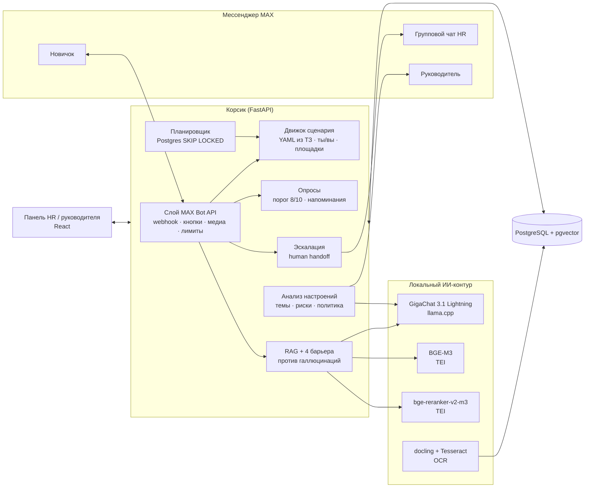

# Корсик — ИИ-ассистент адаптации новичков в мессенджере MAX

Кейс **«Группа ПОЛИПЛАСТИК»** · Молодёжный хакатон «Открой#Моспром» 2026

Корсик ведёт новичка от QR-кода в оффере до конца испытательного срока:
- сам пишет по таймлайну из ТЗ;
- отвечает на вопросы по документам компании с проверяемыми цитатами;
- проводит пульс-опросы и замечает тревожные сигналы;
- когда нужно, бесшовно подключает живого HR прямо в чате MAX.

HR получает панель с тем, что требует внимания сегодня, руководитель — рекомендации по своим новичкам, руководитель подбора — еженедельный дайджест настроений.

---

## Экспертам: версия и статус к третьему чек-поинту

Состояние на 24.10.2026. Для проверки сценариев используйте [релиз 0.2.1](https://github.com/RafaelPozoyan/hack_mosprom/releases/tag/v0.2.1) и [инструкцию запуска ниже](#проверка-сценариев-в-версии-021). [Видеообзор — 2 минуты 34 секунды](https://github.com/RafaelPozoyan/hack_mosprom/releases/download/v0.2.1/korsik-demo-0.2.1.mp4): демонстрационный чат, вымышленные данные, сокращённые переходы и перемотка времени напоминания.

| Статус | Что можно проверить |
|---|---|
| Реализовано в 0.2.1 и проверено в демо | Путь от приглашения до опросов; обязательные ответы и ожидание следующего шага; напоминания и сигнал HR; подтверждение комментария и защита от старых кнопок; обращение к HR, ответ в том же чате и закрытие; вход в панель по паролю |
| Реализовано в коде, есть сохранённые замеры | Поиск по документам с цитатами, контроль ответа, анализ обратной связи и дайджест. Для полного прогона нужны документы и модели; [отчёт поиска](backend/eval/results.md) относится к сохранённому прогону, а не к новому замеру 0.2.1 |
| Дополнительно в `main`, после тега 0.2.1 | Очередь исходящих сообщений сотрудникам и атомарная обработка webhook: [#42](https://github.com/RafaelPozoyan/hack_mosprom/pull/42), [#52](https://github.com/RafaelPozoyan/hack_mosprom/pull/52), [#54](https://github.com/RafaelPozoyan/hack_mosprom/pull/54). Код на `1a5a1ef`: 146 backend-тестов, [CI успешен](https://github.com/RafaelPozoyan/hack_mosprom/actions/runs/40100106358); эти изменения не входят в архив 0.2.1 |
| Не входит в 0.2.1 и в указанную проверку `main` | Новые импорт сотрудников, экран команды, маршрутизация поддержки и живой демо-доступ MAX — отдельные PR #44, #47–#51. Их наличие в PR не означает готовность опубликованной версии |
| Ещё не подтверждено | Полный сценарий с моделями и живым MAX на машине защиты, условия производственного пилота и время ответа на целевом оборудовании |

Это промежуточная версия для обратной связи. Демо показывает работу приложения, но не является приёмкой производственного внедрения. [Вопросы к третьему чек-поинту](#вопросы-к-третьему-чек-поинту) перечислены ниже.

GitHub-репозиторий приватный. Ссылки на код, релиз и видео требуют доступа к нему; открытый доступ для экспертов пока не настроен и по решению команды отложен.

## Что сделано — по требованиям кейса

| Требование кейса | Как реализовано | Где в коде |
|---|---|---|
| Миграция в MAX с сохранением таймлайна и персонализации под площадки | Весь сценарий ТЗ (43 шага, 5 опросов, ветки ответов, варианты для GrPP / GTP / Luzhniki, обращение на «ты» и «вы») перенесён в данные. Слой MAX Bot API: webhook и long polling, inline-кнопки, загрузка изображений и PDF, диплинк из QR, лимиты платформы | `backend/scenario/korsik.yaml`, `backend/app/channels/max.py`, `backend/app/bot/updates.py` |
| Планировщик (CRON) для проактивных рассылок | Очередь задач в Postgres (`FOR UPDATE SKIP LOCKED`), рабочие дни с учётом праздников РФ, часовые пояса площадок, напоминания о непройденном опросе (завтра и послезавтра — как в ТЗ) | `backend/app/scheduler.py`, `backend/app/bot/scenario.py` |
| RAG для вопросов на естественном языке | PDF, Word, PowerPoint, Markdown и текст; сканы — через OCR → фрагменты по структуре пунктов → гибридный поиск (полнотекстовый + векторный BGE-M3, объединение RRF) → переранжирование bge-reranker-v2-m3 → ответ GigaChat с цитатами | `backend/app/rag/` |
| Контроль галлюцинаций | Четыре независимых барьера:<br/>1) порог уверенности поиска;<br/>2) модель сначала выписывает цитаты и только потом решает, есть ли в них ответ;<br/>3) цитата сверяется с текстом документа слово в слово, расходиться могут только окончания. Сотрудник видит только подтверждённые цитаты, а без них ответа нет;<br/>4) каждое число, время, дата, e-mail и ссылка в ответе должны быть в подтверждённом фрагменте.<br/>Не прошёл барьер — бот предлагает передать вопрос HR, а не фантазирует | `backend/app/rag/answer.py`, `backend/tests/test_core.py` |
| Анализ настроений, скрытые проблемы, красные флаги | Аспектный анализ свободных ответов: тональность, эмоции (классы CEDR), темы и риски из формулировок кейса. Политика реакции: срочный флаг HR, push руководителю, приватность (жалобы на руководителя ему не уходят) | `backend/app/analytics/sentiment.py`, раздел `analytics` в сценарии |
| Бесшовная эскалация на живого рекрутера через API MAX | Сотрудник остаётся в чате с Корсиком. HR получает карточку с сутью обращения (готовит ИИ) в групповом чате MAX и в панели. Ответ HR реплаем уходит сотруднику, ИИ на время диалога молчит | `backend/app/bot/escalation.py` |
| Роль 02 — HR-менеджер | Экран «Сегодня»: что требует внимания, кому сегодня нужна поддержка (тревожные ответы за сутки, срочные первыми), на каком этапе новички, о чём спрашивают (по тегам запросов), чего не хватает в базе знаний. Из карточки новичка HR подключает руководителя: выбирает рекомендацию, руководитель получает её без ответов новичка | `web/src/pages/Dashboard.tsx`, `backend/app/analytics/support.py` |
| Роль 03 — руководитель подразделения | Статус адаптации своих сотрудников, рекомендации Корсика и push в MAX о встрече 1:1. Руководитель открывает экран по личной ссылке. Сервер отдаёт по ней только его сотрудников, без свободных ответов, опросов и обращений; сигналы, где есть жалоба на руководителя, не показываются целиком | `backend/app/api/admin.py` (`manager_router`), `web/src/pages/Manager.tsx` |
| Роль 04 — руководитель управления по подбору | Еженедельный дайджест «Настроения в коллективе новичков»: кластеры проблем с цитатами, оценки, выводы. Контроль ответов рекрутеров: срочные обращения сразу в MAX, блок «Просрочено» с кнопкой «Напомнить рекрутеру», время первого ответа HR | `backend/app/analytics/digest.py`, `backend/app/bot/response_time.py` |
| HR обновляет базу знаний без кода | Перетащить PDF, Word или PowerPoint в панель. Сканы, картинки и SmartArt на слайдах тоже читаются | `web/src/pages/Knowledge.tsx`, `backend/app/rag/ingest.py` |
| Гибридный UX: кнопки + свободный диалог | Кнопки ТЗ, команды `/food` и `/hr`, меню. Любой вопрос текстом уходит в ИИ, ответ — с цитатами и оценкой 👍/👎 | `backend/app/bot/dialog.py` |

## Проверка сценариев в версии 0.2.1

0.2.1 — промежуточный MVP для клиентской проверки пути новичка и работы HR. Для этой проверки достаточно приложения и БД, без загрузки моделей и документов. Нужен Docker Compose; команды выполняются из корня репозитория на версии `v0.2.1`.

```bash
# Существующий .env не перезаписываем.
test -f .env || cp .env.example .env
docker compose --profile app up -d --build db api
```

Перед запуском оставьте `MAX_TOKEN` пустым и задайте свой `ADMIN_TOKEN` в `.env`. Откройте http://localhost:8000 и введите этот пароль в форме входа. Доступ сохраняется в текущей вкладке; кнопка «Выйти из панели» очищает его и данные панели из памяти браузера. При неверном пароле или недоступном сервере показана ошибка с возможностью повторить ввод. Это стенд для локальной проверки: Compose публикует порты приложения и БД, поэтому не размещайте его в открытом интернете. Используйте вымышленных сотрудников.

1. В разделе «Сотрудники» создайте новичка с датой выхода сегодня. Включите режим демонстрации внизу слева и откройте карточку.
2. До запуска бота попробуйте перемотку: шаг должен ждать сканирования QR. Нажмите «Новичок сканирует QR» и выберите «ты» или «вы».
3. Перематывайте таймлайн до проверки доступов. Оставьте её без ответа: новый опрос ждёт, справочные сообщения и помощь HR остаются доступны. Ответьте на проверку и продолжите до опроса третьего дня.
4. Ответьте на вопросы. Если появился необязательный комментарий, проверьте его пропуск или подтверждение введённого текста. Нажатие старой кнопки не должно менять новый вопрос.
5. Напишите `/hr`, опишите проблему. В разделе «Обращения» ответьте от HR и закройте обращение; ответ появится в чате новичка.
6. Для проверки напоминаний оставьте обязательный опрос незавершённым и используйте перемотку. Проверяйте подписи планового времени в таймлайне: ускорение работает только в демонстрации.

Без моделей и документов ответы по базе знаний и содержательная аналитика не проверяются: при недоступном поиске бот предлагает HR, для карточки обращения используется резервный текст. Для полного контура следуйте инструкции ниже. Первую сборку может потребоваться подождать, она скачивает зависимости.

**Что собрать у клиентов:** на каком шаге непонятно следующее действие; какие обязательные ответы лишние или отсутствуют; понятны ли HR ожидание, причина задержки и обращение; удобно ли новичку отвечать и просить помощь. Для замечания сохраните роль, площадку, шаг, ожидаемый и фактический результат. Не присылайте персональные данные и реальные переписки в публичные issue.

## Полная демонстрация с локальными моделями

Материалы кейса (ПВТР, политики, ТЗ) в репозитории не хранятся — положите их в папку `materials/`.

```bash
test -f .env || cp .env.example .env
./fetch_models.sh                                                 # GigaChat 3.1 Lightning (6,5 ГБ) и OCR-модель — один раз
docker compose --profile local-llm --profile app up -d --build   # эмбеддинги и реранкер докачаются сами
docker compose exec api python scripts/seed.py /materials kb      # база знаний + демо-сотрудники
```

Откройте http://localhost:8000. Режим демонстрации включён (переключатель внизу слева). Дальше:

1. **Сотрудники → Петров Иван** (ещё не вышел на работу). Справа — чат глазами новичка в MAX. Нажмите «Новичок сканирует QR», выберите «На ВЫ» — дальше все тексты будут на «вы», с вариантами для завода GTP.
2. Нажимайте «Перемотать к следующему шагу» — Корсик пройдёт таймлайн ТЗ: первый день, карта, проверка доступов, обед, опрос третьего дня. Над сообщениями шага стоит плановое время от даты выхода («1-й рабочий день, 12:00 · пн 09.11») по часовому поясу площадки; оно считается так же, как плановые даты в «Пути адаптации» слева. На кнопке видно, какой шаг будет следующим и когда он по плану. У ответов ИИ, ответов HR и справочных сообщений, которые открываются из нескольких мест («Где пообедать»), подписи нет. Подписи показывает только панель, в MAX сообщения приходят без них.
3. В опросе ответьте «Пока ничего не понял» — руководителю уйдёт push «проведите встречу 1:1», а в «Сигналах» появится причина. Новичок появится на «Сегодня» в блоке «Кому сегодня нужна поддержка»; в его карточке нажмите «Подключить руководителя» и выберите рекомендацию.
4. Спросите в чате «Сколько дней отпуска положено?» — ответ придёт с цитатой из Правил внутреннего трудового распорядка. Спросите «Есть ли парковка у офиса?» — бот честно скажет, что не знает, и предложит передать вопрос HR.
5. **Обращения** — карточка с сутью, которую подготовил ИИ. Ответьте — ответ придёт новичку в тот же чат.
6. Переключите роль на «Руководитель» — увидите то же, что руководитель по своей личной ссылке: рекомендации без личных ответов. «Руководитель подбора» → «Настроения» → «Собрать за последнюю неделю».

## Как выглядит панель

Снимки работающей панели, 1440×900. Персонажи и обращения вымышлены: это локальная демонстрация, а не результаты пилота. Чат справа в карточке сотрудника — встроенный демо-чат, не снимок приложения MAX.

**Сегодня:** обращения, требующие ответа, сигналы из опросов и этапы адаптации.


**Карточка сотрудника:** путь адаптации и чат глазами новичка.


**Обращения:** контекст переписки и поле ответа HR в тот же диалог.


Другие экраны: [«Мои новички» руководителя](docs/screenshots/manager.jpg), [«Настроения»](docs/screenshots/mood.jpg), [«База знаний»](docs/screenshots/knowledge.jpg).

На стенде для этих снимков MAX и языковая модель не подключены, документы не загружены. В карточке обращения показан резервный текст по сообщению сотрудника; «Настроения» и «База знаний» сняты в пустом состоянии. Снимки не подтверждают качество ответов модели или доставку в MAX — ограничения и замеры описаны ниже.

## Архитектура



**Почему так**

- **Локальное развёртывание моделей.** GigaChat 3.1 Lightning, BGE-M3, bge-reranker-v2-m3, docling и Tesseract можно запускать в контуре компании. LLM подключается по OpenAI-совместимому API. При выборе внешнего провайдера в `.env` запросы и переданный им контекст уходят этому провайдеру; для материалов кейса используем локальный контур.
- **Сценарий хранится в YAML.** Тексты и настройки площадок меняются в `backend/scenario/korsik.yaml` без изменения Python-кода. Отдельного редактора сценария для HR пока нет.
- **Гибридный поиск + переранжирование.** Лексический поиск ловит точные термины («СНИЛС», «п. 6.7.4»), векторный — перефразировки («во сколько приходить» ↔ «начало работы»). Связка BGE-M3 + bge-reranker-v2-m3 — лучшая на русском IR-бенчмарке RusBEIR ([arXiv:2504.12879](https://arxiv.org/abs/2504.12879)). Константа RRF k=60 взята из Cormack et al., 2009.
- **Документы как есть.** ПВТР — скан на 23 страницы без текстового слоя: docling размечает структуру, Tesseract (tessdata_best `rus`) распознаёт текст. Из распознанного удаляются колонтитулы-штампы («Лист N Листов M»), вложенность разделов восстанавливается по нумерации пунктов («6.4.1» лежит внутри «6.4»). Из презентаций извлекаются текст, таблицы, SmartArt и текст на картинках.
- **Очереди в PostgreSQL.** Отдельный брокер не нужен. Пока запускаем один процесс приложения: блокировки диалогов, SSE и ограничитель запросов MAX находятся в памяти. В `main` сообщения сотрудникам сохраняются в исходящей очереди, а webhook фиксируется вместе с изменениями диалога. При потере подтверждения MAX возможен дубль; прямые уведомления HR пока требуют отдельной доработки.

## Качество: замеры, а не обещания

Набор из 42 вопросов в формулировках новичка по документам компании: на 30 ответ есть в базе знаний, на 12 нет (это проверено поиском по всем документам). Разметка — `backend/eval/questions.yaml`, полный отчёт — `backend/eval/results.md`.

Эти замеры сохранены в репозитории; при выпуске 0.2.0/0.2.1 и последних исправлениях очередей повторный прогон моделей на целевой машине не выполнялся.

**Поиск: вклад каждого компонента.** Hit@N — доля вопросов, для которых нужный фрагмент документа оказался в первых N результатах.

| Режим | Hit@1 | Hit@3 | Hit@5 | MRR |
|---|---|---|---|---|
| Только векторный (BGE-M3) | 73% | 90% | 97% | 0,83 |
| Только полнотекстовый | 47% | 77% | 80% | 0,64 |
| Гибрид (RRF) | 73% | 83% | 93% | 0,81 |
| Гибрид + реранкер | **80%** | **97%** | **97%** | **0,88** |

**Порог уверенности.** Оценка реранкера для лучшего фрагмента: у вопросов с ответом — не ниже 0,041, у вопросов без ответа — не выше 0,032. Порог 0,037 стоит посередине этого зазора и на этом наборе разделяет вопросы без ошибок.

**Сквозной прогон: поиск → GigaChat 3.1 Lightning → четыре проверки** (на CPU)

| | Первая версия | Последний сохранённый замер |
|---|---|---|
| Вопросы вне базы знаний: выдуманных ответов | 0 из 12 | **0 из 12** |
| Вопросы из базы знаний: верный ответ с цитатой | 12 из 30 | **29 из 30** |
| Вопросы из базы знаний: ответ без ключевого факта | 0 из 30 | 0 из 30 |
| Вопросы из базы знаний: передал HR | 18 из 30 | 1 из 30 |

Ответы модели на CPU немного различаются от прогона к прогону. В предыдущем прогоне той же версии было 26 из 30 верных, неверных ответов и выдуманных не было. Единственный вопрос, ушедший HR в последнем прогоне, — про взятку: в скане Антикоррупционной политики колонки распознались вперемешку, и цитата не сходится с текстом. Среднее время ответа на CPU (AMD Ryzen 9 5900X, без видеокарты) — 30,5 с по всем 42 вопросам; оно зависит от загрузки машины.

Что изменилось между замерами — и почему проверки при этом не ослабли:
- модель сначала выписывает цитаты, а только потом решает, есть ли в них ответ. Раньше решение «ответа нет» принималось до чтения источников;
- цитата ищется во всех найденных фрагментах: модель путала номер источника с номером пункта документа («6.6.3» → источник 6);
- допускаются окончания слов («выдача» — «выдачу»), но слова идут подряд: потерять «не» или поменять число цитата не может;
- неподтверждённая цитата отбрасывается и сотруднику не показывается, а числа, время, e-mail и ссылки сверяются только с подтверждёнными фрагментами. Так проверка поймала опечатку модели в адресе корпоративного портала (`my.olyplastic.ru` вместо `my.polyplastic.ru`) — вопрос ушёл HR, а не неверная ссылка новичку.

Повторить замер: `uv run python eval/run_eval.py --e2e` → `backend/eval/results.md`. Unit-тесты детерминированной логики: `uv run pytest`. Покрыты проверка цитат и чисел, приватность руководителя, повторные нажатия кнопок, раздача панели, календарь рабочих дней, рендер «ты/вы», очистка OCR и формат запросов MAX.

## Запуск

### Всё в Docker

```bash
test -f .env || cp .env.example .env
./fetch_models.sh
docker compose --profile local-llm --profile app up -d --build
```

Ресурсы на CPU: около 15 ГБ ОЗУ (замер `docker stats` во время eval: LLM 7,0 ГБ, реранкер 2,8, эмбеддинги 2,7, docling 1,7). Для GPU NVIDIA замените образ LLM на `ghcr.io/ggml-org/llama.cpp:server-cuda` и добавьте `-ngl 99`.

### Разработка

```bash
docker compose --profile local-llm up -d db embed rerank docling llm
cd backend && uv sync && uv run uvicorn app.main:app --reload     # API на :8000
cd web && bun install && bun run dev                               # панель на :5173
```

### Рассылки и восстановление

Владение задачей `jobs` удерживается отдельной транзакцией PostgreSQL до конца обработки, включая промежуточные сохранения сообщений. Старт другого планировщика не сбрасывает активные задачи. После завершения процесса блокировка освобождается, и следующий проход подбирает `running` без владельца. Попытка учитывается до выполнения: прерванная последняя попытка становится `failed`, а для дайджеста создаётся следующая еженедельная задача. Ошибка одной задачи не оставляет остальные задачи пачки захваченными.

Перемотка демо сохраняет запрос до исполнения и возвращает фактическое состояние задачи: выполнена, пропущена, ждёт ответа или повтора. После обрыва запроса сохранённую задачу подберёт планировщик. Она использует ту же блокировку, сохраняет исходную плановую дату и не увеличивает счётчик попыток сама. Пока ближайший шаг выполняется, повторный запрос не запускает следующий шаг. Более поздняя готовая задача одного сотрудника не обгоняет раннюю.

При обновлении сначала остановите старые процессы приложения: предыдущая версия не использует эти блокировки. Отправка в MAX не атомарна с БД; после аварии или потери соединения, удерживающего блокировку, возможны повторные побочные действия. Это ограничение остаётся задачей исходящей доставки.

Проверка с отдельной тестовой БД: `cd backend && TEST_DATABASE_URL=postgresql+asyncpg://... uv run pytest -q`. PostgreSQL-тесты создают и удаляют собственные схемы `scheduler_test_*`, в CI БД поднимается автоматически. Без переменной они пропускаются.

### Подключение бота MAX

1. Создайте бота на платформе MAX и впишите в `.env` переменные `MAX_TOKEN` и `MAX_BOT_NAME`.
2. В проде задайте `MAX_WEBHOOK_URL=https://<домен>/max/webhook` и `MAX_WEBHOOK_SECRET` — подписка оформится при старте. MAX принимает вебхуки только по HTTPS с доверенным сертификатом. Без `MAX_WEBHOOK_URL` используется long polling (по документации MAX — только для разработки).
3. Добавьте бота админом в групповой чат HR и укажите его `MAX_HR_CHAT_ID`. Туда будут приходить карточки обращений, ответ реплаем уходит сотруднику.
4. Руководители и рекрутеры подписываются на уведомления по личной ссылке `https://max.ru/<бот>?start=staff_<код>`.
5. QR-код из карточки сотрудника ведёт на `https://max.ru/<бот>?start=<код>` — бот узнаёт новичка и запускает его путь.

Если сертификат Минцифры не входит в системное хранилище, укажите в `MAX_CA_BUNDLE` путь к набору из публичных корневых сертификатов и сертификатов Минцифры. Один сертификат Минцифры не подойдёт: файлы и картинки загружаются в MAX на другой домен с обычным сертификатом.

```bash
curl -sO https://gu-st.ru/content/lending/russian_trusted_root_ca_pem.crt
curl -sO https://gu-st.ru/content/lending/russian_trusted_sub_ca_pem.crt
{ cat "$(cd backend && uv run python -c 'import certifi; print(certifi.where())')"; echo; cat russian_trusted_root_ca_pem.crt; echo; cat russian_trusted_sub_ca_pem.crt; } > max-ca-bundle.pem
```

### Демо-доступ «попробуйте сами»

Для показов и защиты: `DEMO_TRY_PAYLOAD=try` в `.env`. QR на `https://max.ru/<бот>?start=try` заводит демо-новичка завода GTP на каждого, кто его отсканировал. Время ускорено: шаги приходят по кнопке «⏩ Дальше», а подсказка говорит, когда шаг пришёл бы по плану. Вопросы своими словами, опросы и передача HR работают как у обычного новичка, демо-новички видны в «Сотрудниках». Не больше `DEMO_TRY_LIMIT` (200) демо-новичков. В проде оставьте пустым: новички приходят из панели и кадровой системы.

Вебхук требует токен и секрет: без настройки возвращает 503, с неверным секретом — 403. После сохранения в `max_updates` возвращается 200; при ошибке БД подтверждения нет. Дубликат завершённого события не запускает диалог снова. Обработчик удерживает блокировку строки до результата, а после обрыва соединения незавершённая запись остаётся в очереди. Исходное тело успешного события очищается, ключ дедупликации сохраняется.

При обработке вебхука изменения состояния диалога, записи `Message`, намерения доставки `MaxDelivery` и отметка `MaxUpdate.status = 'done'` фиксируются одной транзакцией. Ошибка обработчика откатывает его изменения, а очередь сохраняет ошибку и срок повтора. Поэтому повтор не применяет заново частично сохранённый ответ опроса. События SSE для панели и запуск фонового анализа откладываются до успешного commit; при откате они не запускаются. Фоновый анализ пока не является устойчивой очередью: авария после commit может прервать или не запустить его.

Ошибки повторяются с паузой по правилам очереди `jobs`. После исчерпания попыток статус становится `failed`, последующие события того же пользователя ждут. Оператор проверяет `SELECT id, actor, status, attempts, error FROM max_updates WHERE status = 'failed'`, устраняет причину и повторно ставит **выбранную** запись: `UPDATE max_updates SET status = 'pending', attempts = 0, available_at = now() WHERE id = <номер> AND status = 'failed'`. Перед повтором нужно сверить прямые отправки в MAX, перечисленные ниже: они ещё могут повториться.

Эта граница транзакции действует только для входящей очереди вебхука. Поллинг и прямые вызовы диалога через API её не используют; поллинг хранит позицию чтения в `data/max_poll_marker`, поэтому перезапуск не повторяет уже обработанные события. Приложение по-прежнему рассчитано на один процесс; изоляция всех конкурентных операций API остаётся отдельной задачей.

Проверка очереди на отдельной тестовой БД: `cd backend && TEST_DATABASE_URL=postgresql+asyncpg://... uv run pytest -q`. Тесты создают и удаляют собственные изолированные схемы; для входящей очереди это `inbox_test_*` и `atomic_test_*`. В CI PostgreSQL поднимается автоматически. Без `TEST_DATABASE_URL` проверки PostgreSQL пропускаются.

### Подключение кадровой системы

Кадровая система (1С и подобные) передаёт новичков по API. Ключ записи — табельный номер: повторная передача обновляет новичка, а не создаёт второго. Задайте в `.env` ключ `HR_API_KEY` (отдельный от пароля панели) и перезапустите Корсика. Без ключа API выключен и отвечает 503, с неверным ключом — 401.

```bash
curl -X POST https://<домен>/api/hr-system/employees \
  -H "Authorization: Bearer $HR_API_KEY" -H "Content-Type: application/json" \
  -d '{"employees": [{"personnel_number": "000501", "full_name": "Орлов Денис Олегович",
       "position": "Инженер-механик", "department": "Цех №1", "site": "GTP",
       "start_date": "2026-11-16", "manager": "Игорь Волков", "recruiter": "Мария Кузнецова"}]}'
```

Обязательные поля: `personnel_number`, `full_name`, `site` (код или название площадки), `start_date` (`2026-11-16` или `16.11.2026`). Руководитель и рекрутер ищутся по ФИО среди сотрудников в панели; если не нашлись, в ответе будет предупреждение, а поле не изменится. Пустые поля не стирают уже заполненные данные. За один запрос — до 500 записей. Ответ: `counts` — сколько записей `new` (создано), `update` (обновлено), `unchanged` (без изменений), `error` (не записано) — и `results` по каждой записи: статус, `employee_id`, ссылка-приглашение в MAX (если задан `MAX_BOT_NAME`), ошибки, предупреждения и изменения.

Перенос даты выхода пересчитывает ещё не отправленные шаги плана, уже отправленные не повторяются. Конец испытательного срока считается заново, как при добавлении вручную. Табельный номер есть только у новичков, пришедших из кадровой системы: добавленного вручную API не узнает и создаст отдельно.

### Подключение кадровой системы

Новичков можно загрузить файлом или передавать из кадровой системы (1С и подобных) по API. В обоих случаях ключ записи — табельный номер: повторная загрузка обновляет новичка, а не создаёт второго.

- **Файл.** «Сотрудники → Загрузить из Excel»: `.xlsx` или `.csv`, в том числе выгрузка 1С в Windows-1251. До записи панель показывает, что будет с каждой строкой: новый, обновится, без изменений или ошибка с причиной. Там же скачивается шаблон с подсказками.
- **API.** Задайте в `.env` ключ `HR_API_KEY` (отдельный от пароля панели) и перезапустите Корсика. Без ключа API выключен и отвечает 503, с неверным ключом — 401.

```bash
curl -X POST https://<домен>/api/hr-system/employees \
  -H "Authorization: Bearer $HR_API_KEY" -H "Content-Type: application/json" \
  -d '{"employees": [{"personnel_number": "000501", "full_name": "Орлов Денис Олегович",
       "position": "Инженер-механик", "department": "Цех №1", "site": "GTP",
       "start_date": "2026-11-16", "manager": "Игорь Волков", "recruiter": "Мария Кузнецова"}]}'
```

Обязательные поля: `personnel_number`, `full_name`, `site` (код или название площадки), `start_date` (`2026-11-16` или `16.11.2026`). Руководитель и рекрутер ищутся по ФИО среди сотрудников в панели; если не нашлись, в ответе будет предупреждение, а поле не изменится. Пустые поля не стирают уже заполненные данные. За один запрос — до 500 записей. Ответ: `counts` — сколько записей `new` (создано), `update` (обновлено), `unchanged` (без изменений), `error` (не записано) — и `results` по каждой записи: статус, `employee_id`, ссылка-приглашение в MAX (если задан `MAX_BOT_NAME`), ошибки, предупреждения и изменения.

Табельный номер сравнивается и хранится без ведущих нулей: Excel превращает «000501» в число 501, и это тот же новичок. Дата выхода должна быть не дальше года от сегодня, иначе строка не загрузится — так отсекается, например, «01.01.0001», которой 1С обозначает пустую дату. Перенос даты выхода пересчитывает ещё не отправленные шаги плана, уже отправленные не повторяются. Конец испытательного срока считается заново, как при добавлении вручную. Табельный номер есть только у новичков из файла или API: добавленного вручную загрузка не узнает и создаст отдельно.


### Исходящие сообщения MAX

Отправки сотрудникам через `channels.send/edit` сохраняются в `max_deliveries` вместе с записью журнала, до обращения к MAX. Два обработчика отправляют сохранённые сообщения независимо от сценария. Ошибка транспорта повторяет доставку, а не весь шаг. Порядок одному получателю сохраняется; медленный чат не задерживает другой. Демо-канал работает локально, а отсутствие токена оставляет назначенные MAX-доставки в очереди без расхода попыток.

Состояния доставки: `pending`, `running`, `done`, `failed`. Перед внешним вызовом сохраняется номер попытки; даже аварийное завершение процесса расходует её. Используется существующий бюджет очереди `jobs`: три попытки с паузами в одну и две минуты перед повторами. Это эксплуатационная настройка команды, не SLA MAX. После перезапуска незавершённая доставка повторяется по сохранённому сроку, а прерванная последняя попытка переходит в `failed` после паузы. Подтверждение MAX и `Message.max_mid` сохраняются вместе; подтверждённая отправка не повторяется. Потеря подтверждения может дать дубль — команда выбрала автоматический повтор при таком исходе.

Правка до отправки обновляет ожидающее сообщение; правка во время отправки ждёт её завершения и затем сохраняется для доставки по полученному идентификатору MAX. Новая правка получает собственный бюджет попыток. Запись в переписке и выполнение шага означают сохранение сообщения для отправки, а не подтверждённую доставку: статус доставки пока проверяется оператором в БД.

Окончательная ошибка блокирует последующие сообщения этого получателя, чтобы не нарушать порядок. Диагностика:

```sql
SELECT message_id, user_id, status, attempts, available_at, error
FROM max_deliveries WHERE status <> 'done' ORDER BY message_id;
```

В `error` сохраняется класс ошибки без текста сообщения и ответа MAX. После устранения причины оператор может повторить **одну выбранную** запись. Проверка фактической переписки поможет оценить риск дубля; автоматического сопоставления сообщений с MAX нет. Вместо `<номер>` подставьте `message_id`:

```sql
BEGIN;
SELECT id FROM messages WHERE id = <номер> FOR UPDATE;
UPDATE max_deliveries SET status = 'pending', attempts = 0,
    available_at = now(), error = NULL
WHERE message_id = <номер> AND status = 'failed';
COMMIT;
```

Таблица создаётся при запуске через `init_db`. Перед обновлением остановите старые процессы и сохраните БД и вложения. Смешанный запуск со старой версией и откат без разбора очереди недопустимы: старый код не знает сохранённых доставок. Проверки восстановления, конкуренции, аварий и редактирования: `TEST_DATABASE_URL=… uv run pytest -q tests/test_outbox.py`; тесты создают собственные схемы `outbox_test_*`.

В обработчике вебхука исходящие сообщения сотруднику сохраняются вместе с состоянием диалога и завершением входящего события. Прямые ответы непривязанным пользователям, служебные ответы при привязке аккаунта и уведомления персоналу/HR-группе пока не проходят через `max_deliveries`: повтор события может повторить эти внешние отправки. Их перевод в очередь остаётся в #14. Фактическая доставка в MAX сохраняет описанный выше риск дубля при потере подтверждения.

### Другая LLM

```bash
# Yandex AI Studio (OpenAI-совместимый API)
LLM_BASE_URL=https://llm.api.cloud.yandex.net/v1
LLM_MODEL=gpt://<folder_id>/yandexgpt/latest
LLM_API_KEY=<ключ>
# если провайдер не поддерживает response_format=json_schema:
LLM_JSON_SCHEMA=false
```

### Подготовка обращений для HR

Обращение и задача подготовки карточки (`jobs.kind = 'handoff'`) сохраняются одной транзакцией. Карточка готовится при ближайшем проходе планировщика; работа LLM не удерживает блокировку диалога новичка. Без MAX резюме сохраняется в панели. Если обращение уже закрыто или удалено, новая карточка не публикуется.

Ошибки доставки карточки и уведомления рекрутеру доходят до механизма повторов. Если идентификатор карточки в HR-чате уже сохранён, повтор не публикует её заново. После исчерпания попыток оператор проверяет `SELECT id, ref, attempts, error FROM jobs WHERE kind = 'handoff' AND status = 'failed'`. Перед ручным повтором нужно проверить фактическую доставку: окно между внешней отправкой и фиксацией результата в БД ещё остаётся.

Новую задачу обрабатывает обновлённый планировщик. Перед обновлением остановите старые процессы: они не знают вид `handoff` и могут ошибочно пометить его выполненным. Восстановление владения задачами после аварии — отдельное исправление планировщика.

### Срок первого ответа HR

За ответ на обращение отвечает рекрутер новичка. Срок первого ответа — 4 рабочих часа, для срочного обращения (красный флаг) — 1 рабочий час. Это настройка команды в разделе `response_time` сценария, а не SLA заказчика. Считается только рабочее время площадки: её часовой пояс, будни без праздников РФ, часы по ПВТР п. 6.6.1. Срок и отметки уведомлений хранятся в таблице `ticket_deadlines`, проверку выполняет задача очереди `jobs.kind = 'response_due'`.

Срочное обращение HR-руководитель (`staff.role = 'head'`) получает в MAX сразу; рекрутеру, как и раньше, уходит одна карточка. Когда срок вышел, рекрутер получает напоминание, HR-руководитель — уведомление, а на экране «Сегодня» появляется блок «Просрочено» с кнопкой «Напомнить рекрутеру». Ответ HR в обращении снимает просрочку, закрытое обращение не напоминает. Отметка сохраняется до отправки: уведомление не повторяется ни при повторе задачи, ни после перезапуска, но при сбое в момент отправки может не дойти. Просроченное обращение в любом случае видно в «Просрочено», там же видно, дошло ли напоминание рекрутеру в MAX. HR-руководитель, который сам ведёт новичка, получает одно сообщение как рекрутер. Показатель «Первый ответ HR» на «Сегодня» — медиана за 30 дней в рабочих часах.

Обращения, созданные до обновления, получают срок от времени создания: они видны в «Просрочено», но уведомлений в MAX о них нет. Перед обновлением остановите старые процессы: они не знают вид `response_due`.

### Ручная отправка шага

Ручной запуск использует владение задачей и сотрудником, общее с планировщиком. Конкурирующий запрос получает 409 и не сохраняет новое вложение; панель объясняет причину и снова разрешает нажатие. Завершённый шаг можно намеренно повторить через API. Ошибка исполнения возвращает 503: задача уже сохранена и будет повторена планировщиком по действующей политике очереди.

Файл сохраняется в `media/`, а его связь с задачей — в новой таблице `step_attachments`, создаваемой при старте. После прерывания запроса планировщик подбирает задачу вместе с вложением. Перед обновлением остановите старые процессы: они не умеют отправлять сохранённые вложения. Резервная копия должна включать БД и `media/`. Если результат сохранения задачи неизвестен из-за обрыва БД, файл остаётся на диске; автоматического удаления таких файлов пока нет.

Это защита от одновременного исполнения, а не гарантия единственной доставки в MAX: при аварии после отправки повтор может продублировать сообщения или файл (#14). До запуска новичком бота ручной запрос возвращает 409 с подсказкой про QR и не читает вложение. Автоматическая задача ждёт в `await_start` без расхода попыток и без отметки об отправке. После старта по QR она возвращается в очередь с плановой датой; просроченные этапы проходят обычные проверки порядка и актуальности. Уведомления руководителю и рекрутеру доступны до старта новичка. Старые ошибочные отметки `done` автоматически не восстанавливаются: их нужно сверить с перепиской и при необходимости повторить шаг после старта.

### Ожидание обязательного ответа

По решению команды обязательны проверка доступов, опрос третьего дня, двух недель и итоговый опрос. Признак хранится в YAML (`required`), текущее ожидание — в `employees.state.required_step`. Отправка сообщения не завершает такое ожидание: требуется ответ «Да»/«Нет» на проверку или прохождение вопросов опроса. Отрицательный ответ также завершает проверку; комментарии можно явно пропустить.

Новый опрос или самопрезентация ждут обязательного ответа. Планировщик сохраняет такой шаг как `jobs.status = 'blocked'`, без расхода попыток и переноса исходной даты. После ответа задачи возвращаются в `pending`. Справочная информация и обращение к HR доступны во время ожидания. Ручной API возвращает 409 с причиной; демо-перемотка также не перезаписывает обязательный опрос. Повтор текущего опроса продолжает ожидаемый вопрос или комментарий, а не начинает опрос заново.

В карточке HR показано, какой обязательный шаг ждёт ответа; плановые даты остаются видны. При отказе ручного запуска панель показывает причину сервера. В демо кнопка «Продолжить» возвращает текущий вопрос без сброса уже полученных ответов.

Накопившиеся обязательные этапы идут по исходным плановым датам: неудачная попытка более раннего этапа также блокирует новый запрос обратной связи до успешного повтора и ответа. Необязательный запрос теряет актуальность при наступлении следующего контрольного опроса; в демо учитывается и уже запущенный будущий опрос. При переходе незавершённый необязательный опрос получает причину пропуска, его ответы сохраняются, напоминания отменяются. Панель показывает причину и исходную дату, без кнопки повторного запуска устаревшего этапа. Справочные сообщения этим правилом не пропускаются.


Демо-перемотка обрабатывает также обязательные напоминания и эскалацию, сохраняя их исходное плановое время.

Для обязательных шагов задачи напоминаний на 24 и 48 часов и сигнал HR на 72 часа сохраняются вместе с ожиданием. Интервалы заданы в `reminder` сценария; это настройка команды для пилота, а не SLA заказчика. Повтор текущего шага не сдвигает сроки и не создаёт новые задачи. Ответ отменяет оставшиеся напоминания и эскалацию; после длительного простоя устаревшие напоминания не отправляются пачкой.

Сигнал — одно сохраняемое обращение HR с низкой срочностью и задачей уведомления рекрутера/HR-чата. Он не включает диалог с HR автоматически, не отправляется руководителю и сохраняется после позднего ответа. Единственность обращения обеспечивается транзакцией; доставка MAX по-прежнему допускает повтор при потере подтверждения (#14/#23). Старый обязательный опрос получает новую очередь при ручном возобновлении: без сохранённого времени начала отсчёт начинается с возобновления. Перед обновлением такие активные опросы нужно проверить в панели.

Кнопки опроса связаны с конкретным его запуском, а пропуск комментария — с конкретным ответом. Кнопка из старого сообщения не меняет текущий ответ; Корсик предлагает вернуться к текущему вопросу. Свободный текст во время ожидания комментария или открытого ответа сначала требует уточнения: «Да, это ответ» сохраняет его в опросе, «Это отдельный вопрос» отправляет в обычный поиск по базе, сохраняя текущий вопрос опроса. До подтверждения текст есть только в переписке. Новое сообщение заменяет ожидающее подтверждение, старые подтверждения не действуют.

Уже начатые обязательные опросы распознаются после обновления; проверку доступов, отправленную старой версией без состояния ожидания, нужно заново запустить из панели. Перед обновлением остановите старые процессы: они не учитывают новое ожидание и формат кнопок. Кнопки старой версии не принимают ответы; «К текущему вопросу» выдаёт актуальные варианты без сброса прогресса. Общий сквозной прогон обязательных шагов выполнен; результаты приведены в релизном PR #24.

## Исправление 0.2.1

Добавлена форма входа для панели с `ADMIN_TOKEN`: в 0.2.0 пароль нельзя было ввести через интерфейс. Проверены неверный пароль, сетевая ошибка, повтор, смена пароля на сервере и выход. Личная ссылка руководителя и открытое локальное демо работают как раньше. Схема БД и сценарий адаптации не менялись; исходящая очередь #42 в патч не входит.

## Рубеж готовности 0.2.0

Завершена фаза сценариев адаптации: обязательные ответы, ожидание в панели, напоминания и сигнал HR, порядок просроченных этапов, привязка кнопок к вопросу и ожидание запуска по QR. В выпуск также входят ранее объединённые исправления входящих событий MAX, восстановления очереди, ручной отправки и обращений HR. Форматирование исходников проверено отдельно в #28 / PR #40, Ruff format и Prettier включены в CI.

Для публикации проверяем финальный коммит:

- установка по lock-файлам: `uv sync --frozen` и `bun install --frozen-lockfile`;
- Ruff format, Ruff lint, полный `TEST_DATABASE_URL=… uv run pytest -q` с PostgreSQL без пропусков тестов БД; Prettier и `bun run build`;
- сборка Docker-образа и запуск с чистой БД: `/health`, панель, её статические файлы и API;
- старт по QR, выбор обращения, ожидание обязательного ответа, опрос, обращение к HR, ответ и закрытие; сохранение состояния после перезапуска;
- совпадение версий в `backend/pyproject.toml`, `backend/uv.lock` и `web/package.json`, зелёный CI и согласие участника команды на слияние;
- отдельный релизный PR в `main`, тег `v0.2.0` на его коммите и GitHub Release с результатами и ограничениями.

Это выпуск для обратной связи по завершённой фазе, а полная приёмка заказчика ещё впереди. Для пилота остаются живой MAX (#5), полный сценарий с документами и моделями на целевой машине (#4) и оставшиеся границы надёжности (#14/#53). Базовая очередь сообщений сотрудникам и атомарность webhook реализованы позднее в `main`; они не входят в тег 0.2.1. При неопределённом результате отправки команда выбрала автоматический повтор с допустимым риском дубля. Доступы, ответственные, сроки реакции и правила хранения данных также требуют согласования. Решения и открытые вопросы — в [docs/research.md](docs/research.md).

Перед обновлением остановите старые процессы и сделайте резервную копию БД и `backend/media/` (в контейнере `/app/media/`). Новые и старые обработчики очередей нельзя запускать вместе. Новые таблицы создаются при старте. Откат на 0.1.0 требует предварительного разбора ожидающих событий MAX, задач `handoff` и состояний обязательных шагов: старый код их корректно не обработает.

## Вопросы к третьему чек-поинту

Показываем путь новичка и работу HR, затем фиксируем решения по оставшимся вопросам:

1. **Обязательные ответы и напоминания.** Подтвердить принятую командой матрицу обязательных шагов и интервалы 24/48/72 часа. Это текущая настройка MVP, а не согласованный SLA заказчика.
2. **Ручные шаги.** Кто отправляет самопрезентацию и адаптационный план? Что делать, если план не готов к назначенной дате?
3. **Ответ рекрутера.** Какой срок реакции, кто подменяет отсутствующего рекрутера и когда HR направления должен вмешаться?
4. **Изменения кадровых данных.** Как пересчитывать путь при переносе выхода, невыходе, смене площадки или руководителя? Какие ответы сохранять?
5. **Документы.** Кто утверждает новую редакцию, как выбирать приоритет при противоречии и выводить старые документы из использования?
6. **Пилот и данные.** На какой площадке и с какими участниками проверяем продукт, какие показатели измеряем, кто видит переписку и каковы сроки её хранения и удаления?

Подтверждённые ответы заказчика и обоснование решений — в [docs/research.md](docs/research.md). Для замечания эксперта нужны роль, шаг, ожидаемый и фактический результат; реальные персональные данные в issue не размещаем.

## Передача решения и дополнительные материалы

По заданию кейса третий чек-поинт проходит 24.10 в 18:00 мск; ссылку и время команды проверяем в личном кабинете. На встрече показываем прогресс и задаём вопросы. Все обязательные артефакты и ссылку на README нужно разместить в личном кабинете до 25.10, 10:00 мск. Основание: выданный организаторами «КЕЙС_ПОЛИПЛАСТИК.pdf», страницы 8–9 и 11; сам файл кейса в репозиторий не включён.

| Материал | Состояние |
|---|---|
| Исходный код | Зафиксированный тег `v0.2.1`; дополнительные исправления `main` указаны отдельно выше. Новый пакет нельзя называть 0.2.1, если он собран с другого коммита |
| README | Описание продукта, запуск, функции, ограничения и вопросы к чек-поинту — этот файл |
| Тизер | [TEASER.md](TEASER.md) |
| Видео | Обзор 0.2.1 и русские субтитры приложены к релизу; живой MAX и работа моделей в нём не демонстрируются |
| Презентация | Черновик в [PR #11](https://github.com/RafaelPozoyan/hack_mosprom/pull/11); готовность финального файла для передачи ещё не подтверждена |
| Доступ экспертам и ссылки в личном кабинете | Отложены по решению команды; приватные GitHub-ссылки не заменяют открытый доступ |

В плане сдачи [#7](https://github.com/RafaelPozoyan/hack_mosprom/issues/7) записаны архив на Яндекс Диске и срок доступа не меньше 90 рабочих дней; в [#2](https://github.com/RafaelPozoyan/hack_mosprom/issues/2) — презентация до 10 МБ. Точный формат архива, этот срок и лимит в PDF кейса не указаны: перед финальной передачей их нужно сверить с актуальным Положением и формой личного кабинета.

В архив исходников включаем код, README, Dockerfile, Compose, файлы зависимостей и `.env.example`. Исключаем `.env`, ключи, базы, реальные переписки, локальные материалы кейса, скачанные модели, зависимости и кэши. Материалы заказчика подключаются локально в `materials/`; в общедоступный пакет они не входят. Перед сдачей проверяем запуск из чистого каталога и доступность всех передаваемых ссылок без входа в аккаунт.

## Для команды

Форматирование проверяется в CI: `cd backend && uv run ruff format --check .` и `cd web && bun run format:check`. Исправить формат можно командами `uv run ruff format .` из `backend/` и `bun run format` из `web/`. Для Python используется существующий лимит 110 символов; Prettier сохраняет принятые в интерфейсе одинарные кавычки, отсутствие точек с запятой и отступ в два пробела. Материалы кейса, зависимости, сборки и локальные настройки инструментов исключены.

- [CONTRIBUTING.md](CONTRIBUTING.md) — правила разработки: ветки и PR, зоны ответственности, проверки перед мержем, правило «только проверяемые цифры», требования к интерфейсу.
- [docs/research.md](docs/research.md) — гипотезы продукта, набросок архитектуры, риски и вопросы к заказчику.
- [TEASER.md](TEASER.md) — тизер решения для личного кабинета.

## Структура

```
backend/
  scenario/korsik.yaml     сценарий ТЗ: шаги, опросы, тексты, площадки, политика рисков
  app/channels/            слой каналов: MAX Bot API и демо-чат панели
  app/bot/                 диалог, сценарий, опросы, эскалация, события MAX
  app/rag/                 загрузка документов, гибридный поиск, ответ с проверками
  app/analytics/           анализ настроений, дайджест, метрики дашборда
  app/scheduler.py         очередь проактивных рассылок
  eval/                    размеченный набор вопросов и замер качества
  tests/                   unit-тесты
  kb/                      памятка новичка (собрана из фактов ТЗ)
  media/                   шаблоны изображений и PDF из ТЗ — HR заменяет своими
web/                       панель HR, руководителя и руководителя подбора
docker-compose.yml         весь стек одной командой
```

## Использование ИИ (п. 4.3.3–4.3.4 Положения)

- Код написан командой с помощью ИИ-ассистента для программирования (Claude Code). Архитектура, логика и проверка — наши.
- В продукте используются модели с открытыми весами: GigaChat 3.1 Lightning (ai-sage, MIT), BGE-M3 и bge-reranker-v2-m3 (BAAI), docling (IBM), Tesseract OCR. Весь код интеграции — в репозитории.
- Тексты Корсика взяты из ТЗ заказчика. Изображения-шаблоны сгенерированы скриптом `backend/scripts/make_media.py`.
