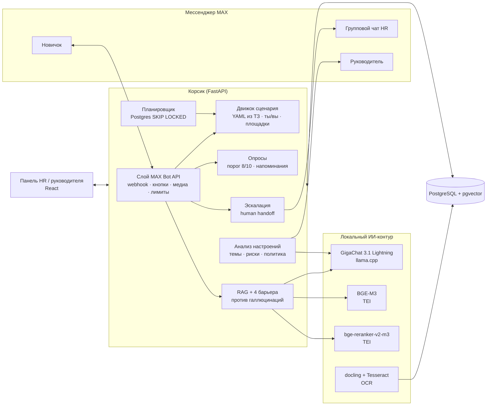

# Корсик — ИИ-ассистент адаптации новичков в мессенджере MAX

Кейс **«Группа ПОЛИПЛАСТИК»** · Молодёжный хакатон «Открой#Моспром» 2026

Корсик ведёт новичка от QR-кода в оффере до конца испытательного срока:
- сам пишет по таймлайну из ТЗ;
- отвечает на вопросы по документам компании и не выдумывает;
- проводит пульс-опросы и замечает тревожные сигналы;
- когда нужно, бесшовно подключает живого HR прямо в чате MAX.

HR получает панель с тем, что требует внимания сегодня, руководитель — рекомендации по своим новичкам, руководитель подбора — еженедельный дайджест настроений.

---

## Что сделано — по требованиям кейса

| Требование кейса | Как реализовано | Где в коде |
|---|---|---|
| Миграция в MAX с сохранением таймлайна и персонализации под площадки | Весь сценарий ТЗ (43 шага, 5 опросов, ветки ответов, варианты для GrPP / GTP / Luzhniki, обращение на «ты» и «вы») перенесён в данные. Слой MAX Bot API: webhook и long polling, inline-кнопки, загрузка изображений и PDF, диплинк из QR, лимиты платформы | `backend/scenario/korsik.yaml`, `backend/app/channels/max.py`, `backend/app/bot/updates.py` |
| Планировщик (CRON) для проактивных рассылок | Очередь задач в Postgres (`FOR UPDATE SKIP LOCKED`), рабочие дни с учётом праздников РФ, часовые пояса площадок, напоминания о непройденном опросе (завтра и послезавтра — как в ТЗ) | `backend/app/scheduler.py`, `backend/app/bot/scenario.py` |
| RAG для вопросов на естественном языке | Документы любого формата (сканы — через OCR) → фрагменты по структуре пунктов → гибридный поиск (полнотекстовый + векторный BGE-M3, объединение RRF) → переранжирование bge-reranker-v2-m3 → ответ GigaChat с цитатами | `backend/app/rag/` |
| Контроль галлюцинаций | Четыре независимых барьера: порог уверенности поиска; модель обязана признать, что ответа нет; каждая цитата проверяется дословно по тексту документа; каждое число в ответе должно быть в источнике. Не прошёл барьер — бот предлагает HR, а не фантазирует | `backend/app/rag/answer.py`, `backend/tests/test_core.py` |
| Анализ настроений, скрытые проблемы, красные флаги | Аспектный анализ свободных ответов: тональность, эмоции (классы CEDR), темы и риски из формулировок кейса. Политика реакции: срочный флаг HR, push руководителю, приватность (жалобы на руководителя ему не уходят) | `backend/app/analytics/sentiment.py`, раздел `analytics` в сценарии |
| Бесшовная эскалация на живого рекрутера через API MAX | Сотрудник остаётся в чате с Корсиком. HR получает карточку с сутью обращения (готовит ИИ) в групповом чате MAX и в панели. Ответ HR реплаем уходит сотруднику, ИИ на время диалога молчит | `backend/app/bot/escalation.py` |
| Роль 02 — HR-менеджер | Экран «Сегодня»: что требует внимания, на каком этапе новички, о чём спрашивают (по тегам запросов), чего не хватает в базе знаний | `web/src/pages/Dashboard.tsx` |
| Роль 03 — руководитель подразделения | Статус адаптации своих сотрудников, рекомендации Корсика и push в MAX о встрече 1:1. Без свободных ответов новичков | `web/src/pages/Manager.tsx` |
| Роль 04 — руководитель управления по подбору | Еженедельный дайджест «Настроения в коллективе новичков»: кластеры проблем с цитатами, оценки, выводы | `backend/app/analytics/digest.py` |
| HR обновляет базу знаний без кода | Перетащить PDF, Word или PowerPoint в панель. Сканы, картинки и SmartArt на слайдах тоже читаются | `web/src/pages/Knowledge.tsx`, `backend/app/rag/ingest.py` |
| Гибридный UX: кнопки + свободный диалог | Кнопки ТЗ, команды `/food` и `/hr`, меню. Любой вопрос текстом уходит в ИИ, ответ — с цитатами и оценкой 👍/👎 | `backend/app/bot/dialog.py` |

## Как посмотреть за 5 минут

Материалы кейса (ПВТР, политики, ТЗ) в репозитории не хранятся — положите их в папку `materials/`.

```bash
cp .env.example .env
./fetch_models.sh                                                 # GigaChat 3.1 Lightning (6,5 ГБ) и OCR-модель — один раз
docker compose --profile local-llm --profile app up -d --build   # эмбеддинги и реранкер докачаются сами
docker compose exec api python scripts/seed.py /materials kb      # база знаний + демо-сотрудники
```

Откройте http://localhost:8000. Режим демонстрации включён (переключатель внизу слева). Дальше:

1. **Сотрудники → Петров Иван** (выходит через 2 дня). Справа — чат глазами новичка в MAX. Нажмите «Новичок сканирует QR», выберите «На ВЫ» — дальше все тексты будут на «вы», с вариантами для завода GTP.
2. Нажимайте «Перемотать к следующему шагу» — Корсик пройдёт таймлайн ТЗ: первый день, карта, проверка доступов, обед, опрос третьего дня.
3. В опросе ответьте «Пока ничего не понял» — руководителю уйдёт push «проведите встречу 1:1», а в «Сигналах» появится причина.
4. Спросите в чате «Сколько дней отпуска положено?» — ответ придёт с цитатой из Правил внутреннего трудового распорядка. Спросите «Есть ли парковка у офиса?» — бот честно скажет, что не знает, и предложит передать вопрос HR.
5. **Обращения** — карточка с сутью, которую подготовил ИИ. Ответьте — ответ придёт новичку в тот же чат.
6. Переключите роль на «Руководитель» — увидите только рекомендации, без личных ответов. «Руководитель подбора» → «Настроения» → «Собрать за последнюю неделю».

## Архитектура



**Почему так**

- **Всё работает в контуре компании.** Модели с открытыми весами (GigaChat 3.1 Lightning — MIT, BGE-M3, bge-reranker-v2-m3, docling, Tesseract) запускаются локально. Внутренние регламенты не уходят во внешние сервисы. Это требование Положения о коммерческой тайне компании и п. 4.3.2 Положения о хакатоне. LLM подключается по OpenAI-совместимому API, поэтому GigaChat API или YandexGPT включаются одной строкой в `.env`.
- **Сценарий — это данные.** Новая площадка или правка текста — изменение `korsik.yaml`, без программиста. Это вторичная проблема кейса: раньше логика бота требовала разработчиков.
- **Гибридный поиск + переранжирование.** Лексический поиск ловит точные термины («СНИЛС», «п. 6.7.4»), векторный — перефразировки («во сколько приходить» ↔ «начало работы»). Связка BGE-M3 + bge-reranker-v2-m3 — лучшая на русском IR-бенчмарке RusBEIR ([arXiv:2504.12879](https://arxiv.org/abs/2504.12879)). Константа RRF k=60 взята из Cormack et al., 2009.
- **Документы как есть.** ПВТР — скан на 23 страницы без текстового слоя: docling размечает структуру, Tesseract (tessdata_best `rus`) распознаёт текст. Из распознанного удаляются колонтитулы-штампы («Лист N Листов M»), вложенность разделов восстанавливается по нумерации пунктов («6.4.1» лежит внутри «6.4»). Из презентаций извлекаются текст, таблицы, SmartArt и текст на картинках.
- **Масштабирование.** API без состояния. Очередь задач — в той же Postgres: воркеров можно поднять сколько угодно, задача не уйдёт дважды. Отдельный брокер не нужен. Лимиты MAX (2 сообщения в секунду в чат, 30 rps) соблюдаются в клиенте.

## Качество: замеры, а не обещания

Набор из 42 вопросов в формулировках новичка по документам компании: на 30 ответ есть в базе знаний, на 12 нет (это проверено поиском по всем документам). Разметка — `backend/eval/questions.yaml`, полный отчёт — `backend/eval/results.md`.

**Поиск: вклад каждого компонента.** Hit@N — доля вопросов, для которых нужный фрагмент документа оказался в первых N результатах.

| Режим | Hit@1 | Hit@3 | Hit@5 | MRR |
|---|---|---|---|---|
| Только векторный (BGE-M3) | 73% | 90% | 97% | 0,83 |
| Только полнотекстовый | 47% | 77% | 80% | 0,64 |
| Гибрид (RRF) | 73% | 83% | 93% | 0,81 |
| Гибрид + реранкер | **80%** | **97%** | **97%** | **0,88** |

**Порог уверенности.** Оценка реранкера для лучшего фрагмента: у вопросов с ответом — не ниже 0,041, у вопросов без ответа — не выше 0,032. Порог 0,037 стоит посередине этого зазора и на этом наборе разделяет вопросы без ошибок.

**Сквозной прогон: поиск → GigaChat 3.1 Lightning → четыре проверки** (на CPU)

| | Результат |
|---|---|
| Вопросы вне базы знаний: выдуманных ответов | **0 из 12** — на каждый бот предложил передать вопрос HR |
| Вопросы из базы знаний: ответил сам | 12 из 30, все 12 верные |
| Вопросы из базы знаний: передал HR | 18 из 30; в 16 случаях цитата модели не совпала дословно с текстом документа |
| Среднее время ответа | 42,5 с |

Повторить замер: `uv run python eval/run_eval.py --e2e` → `backend/eval/results.md`. Unit-тесты детерминированной логики (проверка цитат и чисел, календарь рабочих дней, рендер «ты/вы», очистка OCR, формат запросов MAX): `uv run pytest`.

## Запуск

### Всё в Docker

```bash
cp .env.example .env
./fetch_models.sh
docker compose --profile local-llm --profile app up -d --build
```

Ресурсы на CPU: около 15 ГБ ОЗУ (замер `docker stats` во время eval: LLM 7,0 ГБ, реранкер 2,8, эмбеддинги 2,7, docling 1,7). Для GPU NVIDIA замените образ LLM на `ghcr.io/ggml-org/llama.cpp:server-cuda` и добавьте `-ngl 99`.

### Разработка

```bash
docker compose --profile local-llm up -d db embed rerank docling llm
cd backend && uv sync && uv run uvicorn app.main:app --reload     # API на :8000
cd web && bun install && bun run dev                               # панель на :5173
```

### Подключение бота MAX

1. Создайте бота на платформе MAX и впишите в `.env` переменные `MAX_TOKEN` и `MAX_BOT_NAME`.
2. В проде задайте `MAX_WEBHOOK_URL=https://<домен>/max/webhook` и `MAX_WEBHOOK_SECRET` — подписка оформится при старте. MAX принимает вебхуки только по HTTPS с доверенным сертификатом. Без `MAX_WEBHOOK_URL` используется long polling (по документации MAX — только для разработки).
3. Добавьте бота админом в групповой чат HR и укажите его `MAX_HR_CHAT_ID`. Туда будут приходить карточки обращений, ответ реплаем уходит сотруднику.
4. Руководители и рекрутеры подписываются на уведомления по личной ссылке `https://max.ru/<бот>?start=staff_<код>`.
5. QR-код из карточки сотрудника ведёт на `https://max.ru/<бот>?start=<код>` — бот узнаёт новичка и запускает его путь.

Если сертификат Минцифры не входит в системное хранилище, укажите путь к нему в `MAX_CA_BUNDLE`.

### Другая LLM

```bash
# Yandex AI Studio (OpenAI-совместимый API)
LLM_BASE_URL=https://llm.api.cloud.yandex.net/v1
LLM_MODEL=gpt://<folder_id>/yandexgpt/latest
LLM_API_KEY=<ключ>
# если провайдер не поддерживает response_format=json_schema:
LLM_JSON_SCHEMA=false
```

## Для команды

- [AGENTS.md](AGENTS.md) — правила разработки для людей и ИИ-агентов: ветки и PR, зоны ответственности, проверки перед мержем, правило «только проверяемые цифры», требования к интерфейсу.
- [docs/research.md](docs/research.md) — гипотезы продукта, набросок архитектуры, риски и вопросы к заказчику.
- [TEASER.md](TEASER.md) — тизер решения для личного кабинета.

## Структура

```
backend/
  scenario/korsik.yaml     сценарий ТЗ: шаги, опросы, тексты, площадки, политика рисков
  app/channels/            слой каналов: MAX Bot API и демо-чат панели
  app/bot/                 диалог, сценарий, опросы, эскалация, события MAX
  app/rag/                 загрузка документов, гибридный поиск, ответ с проверками
  app/analytics/           анализ настроений, дайджест, метрики дашборда
  app/scheduler.py         очередь проактивных рассылок
  eval/                    размеченный набор вопросов и замер качества
  tests/                   unit-тесты
  kb/                      памятка новичка (собрана из фактов ТЗ)
  media/                   шаблоны изображений и PDF из ТЗ — HR заменяет своими
web/                       панель HR, руководителя и руководителя подбора
docker-compose.yml         весь стек одной командой
```

## Честно об ограничениях

- Бот MAX проверен на формате API по документации и unit-тестами. Живой прогон в MAX требует зарегистрированного бота, а он оформляется на юрлицо или ИП. Демо идёт через встроенный чат панели, который работает на том же движке.
- Изображения и PDF из ТЗ («Изображение 1–16», открытки, карты, перечень заведений) — шаблоны: оригиналов в материалах кейса нет. HR заменяет их файлами с теми же именами.
- Расписание транспорта, спорткомплекс и заведения у площадок в материалах кейса не описаны. Корсик честно передаёт такие вопросы HR, а они попадают в «Чего не хватает в базе знаний».
- Демо-сотрудники и их ответы вымышлены. Ответы проходят через тот же обработчик, что и сообщения из MAX.

## Использование ИИ (п. 4.3.3–4.3.4 Положения)

- Код написан командой с помощью ИИ-ассистента для программирования (Claude Code). Архитектура, логика и проверка — наши.
- В продукте используются модели с открытыми весами: GigaChat 3.1 Lightning (ai-sage, MIT), BGE-M3 и bge-reranker-v2-m3 (BAAI), docling (IBM), Tesseract OCR. Весь код интеграции — в репозитории.
- Тексты Корсика взяты из ТЗ заказчика. Изображения-шаблоны сгенерированы скриптом `backend/scripts/make_media.py`.
