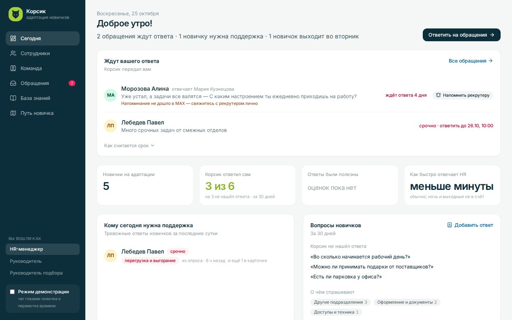
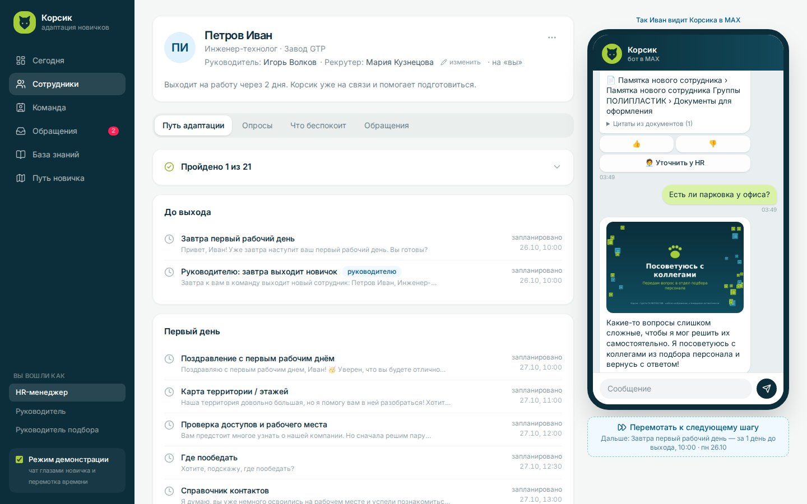
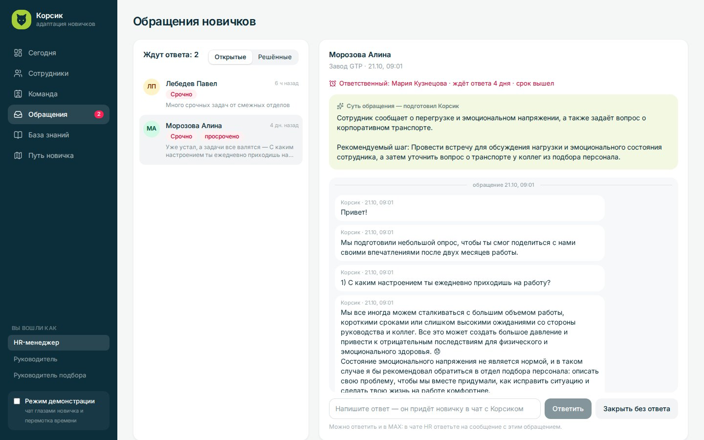
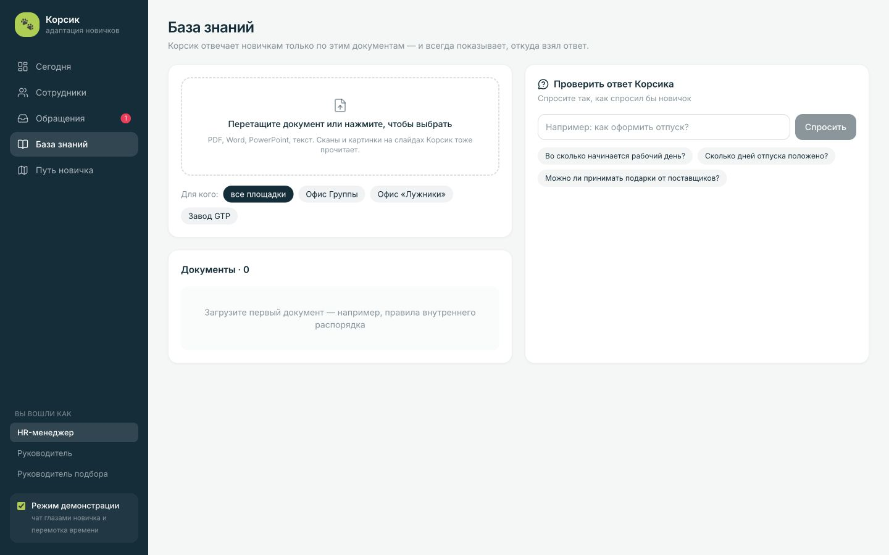
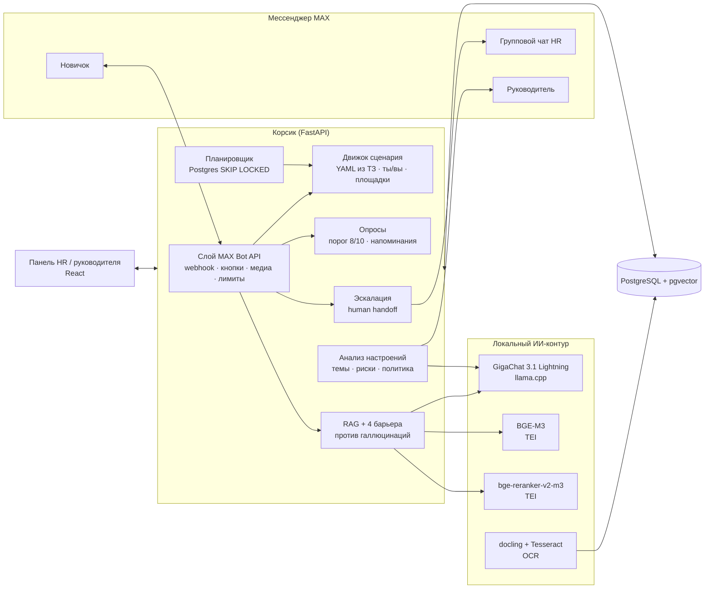

# Корсик — помощник адаптации новичков

Кейс **«Группа ПОЛИПЛАСТИК»** · Молодёжный хакатон «Открой#Моспром» 2026

Корсик помогает новичку пройти путь от приглашения на работу до конца испытательного срока: вовремя напоминает о шагах, отвечает по документам компании и соединяет с рекрутером. Для сотрудника предусмотрен чат в MAX, для HR и руководителей — панель с обращениями, прогрессом и сигналами о трудностях.

- **Новичку** — понятное следующее действие, ответы с цитатами и помощь человека в том же диалоге.
- **HR и рекрутеру** — список того, что требует внимания сегодня, переписка по обращениям и управление новичками, командой и документами.
- **Руководителю** — прогресс своих новичков и рекомендации без их личных ответов; руководителю подбора — сводка настроений и контроль сроков ответа рекрутеров.

## Пять критериев пилота: где проверить

| Критерий заказчика | Что делает Корсик | Где увидеть результат |
|---|---|---|
| Сценарий по датам и времени | Планирует шаги от даты выхода с учётом площадки, рабочего календаря и обращения на «ты» или «вы». Ждёт обязательных ответов и напоминает о них | «Сотрудники» → карточка новичка → путь адаптации и демо-чат. Плановые даты сохраняются при перемотке |
| Ответы из базы знаний | Ищет ответ в загруженных документах, показывает подтверждённые цитаты; при недостаточных основаниях предлагает помощь HR | В демо-чате задать вопрос по открытой памятке и проверить цитату; источник доступен в «Базе знаний» |
| Передача рекрутеру, когда ответа нет | По запросу новичка открывает обращение; рекрутер видит контекст и отвечает в тот же диалог | Демо-чат → вопрос вне памятки → передача HR → «Обращения» → ответ и закрытие |
| Управление данными | Добавляет новичков вручную, из файла или кадровой системы; позволяет назначать рекрутеров и руководителей, управлять командой и загружать документы | «Сотрудники», «Команда», «База знаний» |
| Аналитика | Показывает тревожные ответы, этапы адаптации, сроки реакции HR и сводку настроений | «Сегодня», карточка новичка, «Настроения»; отдельный экран «Мои новички» для руководителя |

README описывает возможности текущей ветки `main`. Импорт сотрудников, экран команды, маршрутизация обращений, сроки ответа HR и восстановление очередей уже включены в код. Веб-демо использует тот же движок диалога; прохождение сценария в нём не подтверждает доставку через настоящий MAX. Условия и показатели пилота ещё согласуются с заказчиком: экономию времени и влияние на удержание предстоит измерить.

Версия для защиты — [релиз 0.3.0](https://github.com/RafaelPozoyan/hack_mosprom/releases/tag/v0.3.0). Презентация для защиты — [docs/korsik-presentation.pdf](docs/korsik-presentation.pdf). Для проверки начните с полного запуска ниже. [Версия 0.2.1 и её видео](#архив-промежуточной-версии-021) сохранены как архив промежуточного результата.

## Полная демонстрация с локальными моделями

Для запуска нужны Git, Docker с Compose v2, Bash, curl и [uv](https://docs.astral.sh/uv/getting-started/installation/) (команда `uvx` загружает модель). На Windows выполняйте команды в WSL2 с Docker Desktop. Рекомендуем выделить Docker не менее 16 ГБ памяти на x86-машине: в проверенном запуске контейнеры после загрузки данных использовали около 13 ГБ. Это ориентир с запасом, а не измеренный минимум; условия замера приведены ниже. На Mac с Apple Silicon TEI запускается через эмуляцию amd64: требуется её поддержка в Docker, работа может быть медленнее. Полный запуск на Mac с 8 ГБ памяти не проверен; используйте [облегчённое демо](#архив-промежуточной-версии-021).

Первый запуск требует интернета и места под образы, модели и их кэш. Только файл GigaChat занимает около 6,5 ГБ; эмбеддинги, реранкер и образы скачиваются отдельно. Docker Desktop должен иметь достаточно выделенной памяти, а не только свободную память хоста.

Команды для чистого клона текущего `main`:

```bash
git clone https://github.com/RafaelPozoyan/hack_mosprom.git
cd hack_mosprom
# Существующий .env не перезаписываем.
test -f .env || cp .env.example .env
./fetch_models.sh
docker compose --profile local-llm --profile app up -d --build --wait --wait-timeout 1800
docker compose exec -T api python scripts/seed.py kb
```

Оставьте `MAX_TOKEN` пустым для локального демо. `up --wait` проверяет готовность всех сервисов через healthcheck, а не только запущенные контейнеры, и завершает команду с ошибкой, если сервисы не готовы за 30 минут. Это настраиваемый запас для первой загрузки, не обещание скорости; при медленном интернете дождитесь завершения скачивания в логах и повторите команду запуска; таймаут не удаляет уже скачанный кэш. При ошибке проверьте `docker compose logs --tail=100 embed rerank llm docling` и повторите проверку перед загрузкой данных.

Исходный код уже содержит открытую памятку в `backend/kb/`. Для этого демо достаточно `seed.py kb`; дополнительные материалы кейса не нужны. В панели «База знаний» проверьте, что памятка обработана: сообщение seed «Готово» само по себе не подтверждает успешную загрузку каждого документа.

Откройте http://localhost:8000. Персонажи в базе вымышленные. Если в `.env` задан `ADMIN_TOKEN`, введите его в форме входа. Включите режим демонстрации внизу слева и пройдите сценарий:

1. **Сотрудники → Петров Иван**. Нажмите «Новичок сканирует QR», выберите «На ВЫ». Это встроенный демо-чат с тем же движком диалога, внешняя доставка MAX здесь не проверяется.
2. Спросите: «Какие фотографии нужны для оформления на завод GTP?». В поставляемой памятке указаны две фотографии 3×4, цветные или чёрно-белые. Проверьте ответ и цитату из памятки.
3. Спросите: «Есть ли парковка у офиса?». В памятке этого нет; Корсик должен предложить обратиться к HR. Передайте вопрос, ответьте из раздела «Обращения» и проверьте ответ в чате новичка.
4. Перематывайте путь до проверки доступов и опроса третьего дня. Обязательный шаг ждёт ответа; во время ожидания доступны справочные сведения и `/hr`.
5. Завершите опрос третьего дня и перемотайте путь до опроса второй недели. На вопрос «Вам понятны поставленные задачи?» ответьте «Нет», введите свободный комментарий и подтвердите его как ответ на опрос. Проверьте сигнал на «Сегодня» и в карточке новичка. Руководителю не должны показываться личные ответы или жалоба на него.
6. Проверьте роли «Руководитель» и «Руководитель подбора», экран «Команда», сроки ответа HR и сводку настроений.

Для повторного запуска используются сохранённые Docker-тома и модельный кэш. Если нужен другой каталог GGUF, задайте `export MODELS_DIR=/абсолютный/путь` **до** `fetch_models.sh` и Compose: значение только в `.env` не передаётся скрипту загрузки. Порты 8000, 55433, 8081–8083 и 5001 должны быть свободны. `docker compose --profile local-llm --profile app down` останавливает стенд; `down -v` удаляет его базу и кэш, поэтому для обычной остановки не используйте `-v`.

**Проверка запуска 25.10.2026.** По [протоколу команды](https://github.com/RafaelPozoyan/hack_mosprom/issues/69#issuecomment-6391773013), чистый клон `7f0d7b7` прошёл инструкцию на Ryzen 9 5900X, WSL2 с 47 ГБ памяти, с моделью на CPU. Использованы отдельный Compose-проект `korsik-cold`, новые тома БД и кэша TEI; порты изменены через override для изоляции от рабочего стенда. Образы зависимостей и GGUF уже были на машине, образ приложения собран заново.

| Этап или ресурс | Результат проверки |
|---|---|
| Сборка и `up --wait` | 5 мин 11 с; все шесть сервисов `healthy`, включая загрузку BGE-M3 и реранкера в новый кэш |
| `seed.py kb` | 187 с; открытая памятка обработана и доступна в «Базе знаний» |
| Вопрос о фотографиях | Ответ за 16,8 с: две фотографии 3×4, цветные или чёрно-белые, с цитатой из памятки |
| Вопрос о парковке | Отказ за 4,6 с; обращение создано, ответ HR появился в чате новичка |
| Память контейнеров после загрузки данных | Около 13 ГБ суммарно по `docker stats`; это снимок потребления, не пик |
| Диск | Новый кэш TEI — 4,6 ГБ; GGUF и Docker-образы занимают место отдельно |

Полное время от клона до первого ответа, скачивание образов и GGUF, пиковая память и общий расход диска не измерены. Проверка подтверждает запуск и путь вопрос → цитата / помощь HR в веб-демо; доставку через MAX она не проверяет.

## Качество ответов: что измерено

В [размеченном наборе](backend/eval/questions.yaml) — 42 вопроса по корпусу кейса: для 30 ответ есть в базе, для 12 — отсутствует. Таблица показывает сохранённые прогоны команды, а не гарантии для любого вопроса или оборудования.

| Конфигурация | Кандидатов для повторного ранжирования | Ответов с цитатой, прошедших автоматическую оценку | Ложных ответов на вопросы вне базы | Среднее время | Источник |
|---|---|---|---|---|---|
| CPU, AMD Ryzen 9 5900X; без подбора потоков | 20 | 29 из 30 | 0 из 12 | 30,5 с | [Сохранённый отчёт](backend/eval/results.md), [описание конфигурации](https://github.com/RafaelPozoyan/hack_mosprom/issues/69#issuecomment-6391498552) |
| Настольная NVIDIA RTX 2070 8 ГБ, AMD Ryzen 9 5900X; до ускорения | 20 | 26 из 30 | 0 из 12 | 10,0 с | [Сводка прогона 24.10](https://github.com/RafaelPozoyan/hack_mosprom/issues/69#issuecomment-6391192259) |
| Та же RTX 2070 и процессор; `66b07c7`, 25.10 | 10 | 27 из 30 | 0 из 12 | 5,6 с | [Сводка прогона после ускорения](https://github.com/RafaelPozoyan/hack_mosprom/issues/69#issuecomment-6391192259) |
| Та же RTX 2070 и процессор; обновлённая памятка, 25.10 | 10 | 26 из 30 | 0 из 12 | 5,8 с | [Таблица и разбор в #98](https://github.com/RafaelPozoyan/hack_mosprom/pull/98) |

На видеокарте работает GigaChat 3.1 Lightning в формате q4_K_M через llama.cpp, с четырьмя слотами обработки; BGE-M3 и повторное ранжирование bge-reranker-v2-m3 работают на CPU. Среднее время во всех строках посчитано **по всем 42 вопросам, включая отказы**. Это время обработки вопроса внутри приложения, без доставки MAX. Между прогонами результат колебался от 26 до 29 ответов из 30 — по [сводке команды](https://github.com/RafaelPozoyan/hack_mosprom/issues/69#issuecomment-6391192259). Последний принятый прогон — после обновления открытой памятки: расхождение с предыдущим на двух вопросах по документам, которые не менялись, поиск не изменился.

В [сохранённом отчёте поиска](backend/eval/results.md) нужный фрагмент найден первым для 80% вопросов и среди первых пяти для 97%. В новом GPU-прогоне эти показатели совпали; доли относятся к вопросам с ответом в базе. Наличие нужного фрагмента ещё не означает, что сформирован правильный ответ.

**Как проверять.** При запущенных моделях и БД, с настроенными адресами сервисов:

```bash
cd backend
uv run python eval/run_eval.py --e2e
```

Команда записывает новый отчёт в `backend/eval/results.md`. Для сопоставимого замера нужны тот же корпус, настройки и версия кода. **Поставка с одной открытой памяткой (`seed.py kb`) не воспроизводит эти результаты:** в ней нет полного корпуса кейса. Закрытые документы в репозиторий и публичные сервисы не загружаются; без доступа к корпусу можно проверить путь вопроса и цитату на открытой памятке, но нельзя сравнивать итоговые доли с таблицей.

**Границы оценки.** В [скрипте замера](backend/eval/run_eval.py) `has_facts` ищет ожидаемые фрагменты текста в ответе; при пустом списке ожидаемых фактов дополнительной проверки содержания нет. Это автоматическая проверка разметки, не независимая экспертная оценка смысла. Порог отказа подбирается на том же наборе вопросов, поэтому результат не является проверкой на отдельной контрольной выборке. Ноль ложных ответов в этих прогонах не означает, что модель никогда не ошибается.

## Границы текущей версии

- **MAX и оборудование.** Подключение MAX реализовано, но полный живой прогон с токеном и всеми маршрутами доставки ещё требует подтверждения. Запуск на x86 с открытой памяткой проверен в условиях, описанных выше; минимальные требования и запуск без заранее скачанных образов и GGUF не измерены. Встроенный чат позволяет проверить сценарий отдельно от транспорта.
- **Доступ к панели.** `ADMIN_TOKEN` — общий пароль, а не отдельные учётные записи сотрудников. Личная ссылка руководителя ограничивает доступ на сервере его новичками; переключатель ролей в панели служит демонстрации. Перед рабочим пилотом нужны согласованные права доступа и способ входа. Локальный Compose-стенд не следует публиковать напрямую в интернете.
- **Надёжность доставки.** Сообщения сотрудникам сохраняются в очереди, а изменения диалога при обработке webhook — вместе с входящим событием. При потере подтверждения MAX автоматический повтор может дать дубль. Прямые уведомления персоналу и HR-группе ещё имеют отдельные окна потери или повторной отправки. Атомарность webhook не распространяется на поллинг и все вызовы API; приложение рассчитано на один процесс. Задания анализа сохраняются вместе с ответами и восстанавливаются после перезапуска; ошибки применения доступны оператору.
- **Документы и ответы модели.** Проверки цитат и чисел снижают риск ошибки, но не заменяют проверку источников владельцем базы знаний. Плохое распознавание скана, устаревший или противоречивый документ могут привести к отказу или неверной интерпретации. При недоступности моделей остаётся сценарий и обращение HR, полноценный поиск и аналитика недоступны.
- **Пилот и персональные данные.** Демо-сотрудники и переписки вымышлены. Сроки реакции, правила хранения и удаления, порядок замещения рекрутера и показатели результата нужно согласовать. Интервалы напоминаний и сроки ответа в сценарии — настройки команды, не утверждённые обязательства заказчика. Редактор сценария для HR пока отсутствует: тексты и правила меняются в файле сценария.

## Дорожная карта — планы

- Измерить полный запуск без кэша образов и GGUF, пиковые ресурсы и общий расход диска; пройти реальные маршруты MAX: новичок, рекрутер, HR-группа и руководитель.
- Согласовать пилот: площадку, участников, права доступа, сроки реакции и хранения данных; измерить исходные затраты времени HR и результат использования.
- Доработать доставку уведомлений персоналу и наблюдение за ошибками очередей.
- Проверить качество на новых вопросах с оценкой эксперта, согласовать обновление документов и правила изменений кадровых данных.
- Подобрать потоки локальных моделей на целевом CPU по замеру до и после — [задача #4](https://github.com/RafaelPozoyan/hack_mosprom/issues/4), отложенная до завершения защиты. Текущие результаты не подтверждают ускорение подбором потоков.

Следующий релиз — по итогам пилота. Принятые решения и открытые вопросы собраны в [docs/research.md](docs/research.md).

## Как выглядит панель

Снимки сделаны на стенде из [полной демонстрации](#полная-демонстрация-с-локальными-моделями) после `seed.py kb`: открытая памятка, вымышленные сотрудники, модели на CPU, MAX не подключён. Это локальная демонстрация, а не результаты пилота. Чат справа в карточке сотрудника — встроенный демо-чат, не снимок приложения MAX.

**Сегодня:** обращения, которые ждут ответа, кому нужна поддержка, на какие вопросы Корсик ответил сам и каких ответов не хватает в базе знаний.



**Карточка сотрудника:** путь адаптации и чат глазами новичка — ответ по памятке со ссылкой на раздел и честный отказ на вопрос, которого в памятке нет.



**Обращения:** суть обращения, которую подготовил Корсик, переписка и ответ HR в тот же диалог.



**База знаний:** проверка ответа Корсика с цитатой из документа.



Другие экраны: [«Мои новички» руководителя](docs/screenshots/manager.jpg), [«Настроения»](docs/screenshots/mood.jpg).

## Где искать реализацию

| Возможность | Основные файлы |
|---|---|
| Даты, площадки, обращение на «ты/вы», обязательные ответы и напоминания | `backend/scenario/korsik.yaml`, `backend/app/bot/scenario.py`, `backend/app/bot/surveys.py`, `backend/app/scheduler.py` |
| Вопросы по документам и проверка цитат | `backend/app/rag/`, `backend/eval/` |
| Обращение рекрутеру и срок первого ответа | `backend/app/bot/escalation.py`, `backend/app/bot/response_time.py` |
| Импорт новичков и управление командой | `backend/app/api/hr_import.py`, `backend/app/api/team.py`, `web/src/pages/` |
| Настроения, сигналы и рекомендации | `backend/app/analytics/`, `backend/app/api/support.py` |
| MAX, входящая очередь и исходящая доставка | `backend/app/channels/`, `backend/app/bot/inbox.py`, `backend/app/bot/updates.py` |

## Архитектура



**Почему так**

- **Локальное развёртывание моделей.** GigaChat 3.1 Lightning, BGE-M3, bge-reranker-v2-m3, docling и Tesseract можно запускать в контуре компании. LLM подключается по OpenAI-совместимому API. При выборе внешнего провайдера в `.env` запросы и переданный им контекст уходят этому провайдеру; для материалов кейса используем локальный контур. Чат использует внешний MAX Bot API: сообщения и отправленные вложения передаются в MAX.
- **Сценарий хранится в YAML.** Тексты и настройки площадок меняются в `backend/scenario/korsik.yaml` без изменения Python-кода. Отдельного редактора сценария для HR пока нет.
- **Гибридный поиск + переранжирование.** Лексический поиск ловит точные термины («СНИЛС», «п. 6.7.4»), векторный — перефразировки («во сколько приходить» ↔ «начало работы»). Связка BGE-M3 + bge-reranker-v2-m3 — лучшая на русском IR-бенчмарке RusBEIR ([arXiv:2504.12879](https://arxiv.org/abs/2504.12879)). Константа RRF k=60 взята из Cormack et al., 2009.
- **Документы как есть.** Для сканов docling размечает структуру, Tesseract (tessdata_best `rus`) распознаёт текст. Из распознанного удаляются колонтитулы-штампы («Лист N Листов M»), вложенность разделов восстанавливается по нумерации пунктов («6.4.1» лежит внутри «6.4»). Из презентаций извлекаются текст, таблицы, SmartArt и текст на картинках.
- **Очереди в PostgreSQL.** Отдельный брокер не нужен. Пока запускаем один процесс приложения: блокировки диалогов, SSE и ограничитель запросов MAX находятся в памяти. В `main` сообщения сотрудникам сохраняются в исходящей очереди, а webhook фиксируется вместе с изменениями диалога. При потере подтверждения MAX возможен дубль; прямые уведомления HR пока требуют отдельной доработки.

## Техническая настройка и эксплуатация

### Всё в Docker

Следуйте [полной инструкции выше](#полная-демонстрация-с-локальными-моделями): подготовка моделей → запуск приложения и моделей с `--wait` → загрузка открытой памятки.

Ресурсы на CPU: около 15 ГБ ОЗУ (исторический замер команды `docker stats` во время eval: LLM 7,0 ГБ, реранкер 2,8, эмбеддинги 2,7, docling 1,7). Это не замер холодного запуска на текущем `main`. Для GPU NVIDIA замените образ LLM на `ghcr.io/ggml-org/llama.cpp:server-cuda` и добавьте `-ngl 99`.

### Разработка

```bash
docker compose --profile local-llm up -d db embed rerank docling llm
# В отдельном терминале из корня репозитория:
cd backend && uv sync && uv run uvicorn app.main:app --reload  # API на :8000
# В другом терминале из корня репозитория:
cd web && bun install && bun run dev                         # панель на :5173
```

### Рассылки и восстановление

Владение задачей `jobs` удерживается отдельной транзакцией PostgreSQL до конца обработки, включая промежуточные сохранения сообщений. Старт другого планировщика не сбрасывает активные задачи. После завершения процесса блокировка освобождается, и следующий проход подбирает `running` без владельца. Попытка учитывается до выполнения: прерванная последняя попытка становится `failed`, а для дайджеста создаётся следующая еженедельная задача. Ошибка одной задачи не оставляет остальные задачи пачки захваченными.

Перемотка демо сохраняет запрос до исполнения и возвращает фактическое состояние задачи: выполнена, пропущена, ждёт ответа или повтора. После обрыва запроса сохранённую задачу подберёт планировщик. Она использует ту же блокировку, сохраняет исходную плановую дату и не увеличивает счётчик попыток сама. Пока ближайший шаг выполняется, повторный запрос не запускает следующий шаг. Более поздняя готовая задача одного сотрудника не обгоняет раннюю.

При обновлении сначала остановите старые процессы приложения: предыдущая версия не использует эти блокировки. Отправка в MAX не атомарна с БД; после аварии или потери соединения, удерживающего блокировку, возможны повторные побочные действия. Исходящая очередь снижает риск повторов сообщений сотрудникам; её границы описаны ниже.

Проверка с отдельной тестовой БД: `cd backend && TEST_DATABASE_URL=postgresql+asyncpg://... uv run pytest -q`. PostgreSQL-тесты создают и удаляют собственные схемы `scheduler_test_*`, в CI БД поднимается автоматически. Без переменной они пропускаются.

### Подключение бота MAX

1. Создайте бота на платформе MAX и впишите в `.env` переменные `MAX_TOKEN` и `MAX_BOT_NAME`.
2. В проде задайте `MAX_WEBHOOK_URL=https://<домен>/max/webhook` и `MAX_WEBHOOK_SECRET` — подписка оформится при старте. MAX принимает вебхуки только по HTTPS с доверенным сертификатом. Без `MAX_WEBHOOK_URL` используется long polling (по документации MAX — только для разработки).
3. Добавьте бота админом в групповой чат HR и укажите его `MAX_HR_CHAT_ID`. Туда будут приходить карточки обращений, ответ реплаем уходит сотруднику.
4. Руководители и рекрутеры подписываются на уведомления по личной ссылке `https://max.ru/<бот>?start=staff_<код>`. Ссылку и QR-код выдаёт экран «Команда»: там же видно, кто уже подключён, и там добавляют, переименовывают и убирают людей.
5. QR-код из карточки сотрудника ведёт на `https://max.ru/<бот>?start=<код>` — бот узнаёт новичка и запускает его путь.

Если сертификат Минцифры не входит в системное хранилище, укажите в `MAX_CA_BUNDLE` путь к набору из публичных корневых сертификатов и сертификатов Минцифры. Один сертификат Минцифры не подойдёт: файлы и картинки загружаются в MAX на другой домен с обычным сертификатом.

```bash
curl -sO https://gu-st.ru/content/lending/russian_trusted_root_ca_pem.crt
curl -sO https://gu-st.ru/content/lending/russian_trusted_sub_ca_pem.crt
{ cat "$(cd backend && uv run python -c 'import certifi; print(certifi.where())')"; echo; cat russian_trusted_root_ca_pem.crt; echo; cat russian_trusted_sub_ca_pem.crt; } > max-ca-bundle.pem
```

### Демо-доступ «попробуйте сами»

Для показов и защиты: `DEMO_TRY_PAYLOAD=try` в `.env`. QR на `https://max.ru/<бот>?start=try` заводит демо-новичка завода GTP на каждого, кто его отсканировал. Время ускорено: шаги приходят по кнопке «⏩ Дальше», а подсказка говорит, когда шаг пришёл бы по плану. Вопросы своими словами, опросы и передача HR работают как у обычного новичка, демо-новички видны в «Сотрудниках». Не больше `DEMO_TRY_LIMIT` (200) демо-новичков. В проде оставьте пустым: новички приходят из панели и кадровой системы.

Вебхук требует токен и секрет: без настройки возвращает 503, с неверным секретом — 403. После сохранения в `max_updates` возвращается 200; при ошибке БД подтверждения нет. Дубликат завершённого события не запускает диалог снова. Обработчик удерживает блокировку строки до результата, а после обрыва соединения незавершённая запись остаётся в очереди. Исходное тело успешного события очищается, ключ дедупликации сохраняется.

При обработке вебхука изменения состояния диалога, записи `Message`, намерения доставки `MaxDelivery` и отметка `MaxUpdate.status = 'done'` фиксируются одной транзакцией. Ошибка обработчика откатывает его изменения, а очередь сохраняет ошибку и срок повтора. Поэтому повтор не применяет заново частично сохранённый ответ опроса. События SSE для панели откладываются до успешного commit. Задания анализа сохраняются вместе с ответами в analysis_tasks: при откате не появляются, после перезапуска подбираются фоновым обработчиком.

Ошибки повторяются с паузой по правилам очереди `jobs`. После исчерпания попыток статус становится `failed`, последующие события того же пользователя ждут. Оператор проверяет `SELECT id, actor, status, attempts, error FROM max_updates WHERE status = 'failed'`, устраняет причину и повторно ставит **выбранную** запись: `UPDATE max_updates SET status = 'pending', attempts = 0, available_at = now() WHERE id = <номер> AND status = 'failed'`. Перед повтором нужно сверить прямые отправки в MAX, перечисленные ниже: они ещё могут повториться.

Эта граница транзакции действует только для входящей очереди вебхука. Поллинг и прямые вызовы диалога через API её не используют; поллинг хранит позицию чтения в `data/max_poll_marker`, поэтому перезапуск не повторяет уже обработанные события. Приложение по-прежнему рассчитано на один процесс; общие блокировки защищают пересечение ответа HR и закрытия обращения с диалогом новичка, но не делают все операции API атомарными.

Проверка очереди на отдельной тестовой БД: `cd backend && TEST_DATABASE_URL=postgresql+asyncpg://... uv run pytest -q`. Тесты создают и удаляют собственные изолированные схемы; для входящей очереди это `inbox_test_*` и `atomic_test_*`. В CI PostgreSQL поднимается автоматически. Без `TEST_DATABASE_URL` проверки PostgreSQL пропускаются.

### Подключение кадровой системы

Новичков можно загрузить файлом или передавать из кадровой системы (1С и подобных) по API. В обоих случаях ключ записи — табельный номер: повторная загрузка обновляет новичка, а не создаёт второго.

- **Файл.** «Сотрудники → Загрузить из Excel»: `.xlsx` или `.csv`, в том числе выгрузка 1С в Windows-1251. До записи панель показывает, что будет с каждой строкой: новый, обновится, без изменений или ошибка с причиной. Там же скачивается шаблон с подсказками.
- **API.** Задайте в `.env` ключ `HR_API_KEY` (отдельный от пароля панели) и перезапустите Корсика. Без ключа API выключен и отвечает 503, с неверным ключом — 401.

```bash
curl -X POST https://<домен>/api/hr-system/employees \
  -H "Authorization: Bearer $HR_API_KEY" -H "Content-Type: application/json" \
  -d '{"employees": [{"personnel_number": "000501", "full_name": "Орлов Денис Олегович",
       "position": "Инженер-механик", "department": "Цех №1", "site": "GTP",
       "start_date": "2026-11-16", "manager": "Игорь Волков", "recruiter": "Мария Кузнецова"}]}'
```

Обязательные поля: `personnel_number`, `full_name`, `site` (код или название площадки), `start_date` (`2026-11-16` или `16.11.2026`). Руководитель и рекрутер ищутся по ФИО среди сотрудников в панели; если не нашлись, в ответе будет предупреждение, а поле не изменится. Пустые поля не стирают уже заполненные данные. За один запрос — до 500 записей. Ответ: `counts` — сколько записей `new` (создано), `update` (обновлено), `unchanged` (без изменений), `error` (не записано) — и `results` по каждой записи: статус, `employee_id`, ссылка-приглашение в MAX (если задан `MAX_BOT_NAME`), ошибки, предупреждения и изменения.

Табельный номер сравнивается и хранится без ведущих нулей: Excel превращает «000501» в число 501, и это тот же новичок. Дата выхода должна быть не дальше года от сегодня, иначе строка не загрузится — так отсекается, например, «01.01.0001», которой 1С обозначает пустую дату. Перенос даты выхода пересчитывает ещё не отправленные шаги плана, уже отправленные не повторяются. Конец испытательного срока считается заново, как при добавлении вручную. Табельный номер есть только у новичков из файла или API: добавленного вручную загрузка не узнает и создаст отдельно.

### Исходящие сообщения MAX

Отправки сотрудникам через `channels.send/edit` сохраняются в `max_deliveries` вместе с записью журнала, до обращения к MAX. Два обработчика отправляют сохранённые сообщения независимо от сценария. Ошибка транспорта повторяет доставку, а не весь шаг. Порядок одному получателю сохраняется; медленный чат не задерживает другой. Демо-канал работает локально, а отсутствие токена оставляет назначенные MAX-доставки в очереди без расхода попыток.

Состояния доставки: `pending`, `running`, `done`, `failed`. Перед внешним вызовом сохраняется номер попытки; даже аварийное завершение процесса расходует её. Используется существующий бюджет очереди `jobs`: три попытки с паузами в одну и две минуты перед повторами. Это эксплуатационная настройка команды, не SLA MAX. После перезапуска незавершённая доставка повторяется по сохранённому сроку, а прерванная последняя попытка переходит в `failed` после паузы. Подтверждение MAX и `Message.max_mid` сохраняются вместе; подтверждённая отправка не повторяется. Потеря подтверждения может дать дубль — команда выбрала автоматический повтор при таком исходе.

Правка до отправки обновляет ожидающее сообщение; правка во время отправки ждёт её завершения и затем сохраняется для доставки по полученному идентификатору MAX. Новая правка получает собственный бюджет попыток. Запись в переписке и выполнение шага означают сохранение сообщения для отправки, а не подтверждённую доставку: статус доставки пока проверяется оператором в БД.

Окончательная ошибка блокирует последующие сообщения этого получателя, чтобы не нарушать порядок. Диагностика:

```sql
SELECT message_id, user_id, status, attempts, available_at, error
FROM max_deliveries WHERE status <> 'done' ORDER BY message_id;
```

В `error` сохраняется класс ошибки без текста сообщения и ответа MAX. После устранения причины оператор может повторить **одну выбранную** запись. Проверка фактической переписки поможет оценить риск дубля; автоматического сопоставления сообщений с MAX нет. Вместо `<номер>` подставьте `message_id`:

```sql
BEGIN;
SELECT id FROM messages WHERE id = <номер> FOR UPDATE;
UPDATE max_deliveries SET status = 'pending', attempts = 0,
    available_at = now(), error = NULL
WHERE message_id = <номер> AND status = 'failed';
COMMIT;
```

Таблица создаётся при запуске через `init_db`. Перед обновлением остановите старые процессы и сохраните БД и вложения. Смешанный запуск со старой версией и откат без разбора очереди недопустимы: старый код не знает сохранённых доставок. Проверки восстановления, конкуренции, аварий и редактирования: `TEST_DATABASE_URL=… uv run pytest -q tests/test_outbox.py`; тесты создают собственные схемы `outbox_test_*`.

В обработчике вебхука исходящие сообщения сотруднику сохраняются вместе с состоянием диалога и завершением входящего события. Прямые ответы непривязанным пользователям, служебные ответы при привязке аккаунта и уведомления персоналу/HR-группе пока не проходят через `max_deliveries`: повтор события может повторить эти внешние отправки. Их перевод в очередь остаётся в #14. Фактическая доставка в MAX сохраняет описанный выше риск дубля при потере подтверждения.

### Фоновый анализ ответов

Задание `analysis_tasks` сохраняет текст и контекст вместе с Question или SurveyAnswer; повторная постановка того же ответа не создаёт второй разбор. LLM не удерживает блокировку диалога. После неё результат анализа, реакция и отметка `done` фиксируются одной транзакцией; сбой применения откатывает их вместе. Удаление сотрудника удаляет и его задачи, включая те, которые ждут модель.

Обычная ошибка модели повторяется до трёх попыток с паузами по правилам очереди. При явном тревожном флаге из ответа резервная реакция выполняется уже после первой ошибки LLM. Успешно завершённая задача очищает исходный payload, а при резервной реакции сохраняет тип ошибки. `failed` означает исчерпанные попытки анализа или применения; исходный payload сохраняется для повторной обработки. Оператор проверяет `SELECT id, status, attempts, error FROM analysis_tasks WHERE status = 'failed'`, устраняет причину и возвращает только выбранную задачу в `pending` со сбросом attempts и available_at. Задачи `done` повторно не запускают.

Перед обновлением остановите старый процесс, чтобы он не продолжал несохраняемый анализ через create_task. Таблица создаётся штатным init_db; перезапуск не требует очищать данные. Проверки: `TEST_DATABASE_URL=… uv run pytest -q tests/test_analysis_queue.py tests/test_inbox_atomic.py`.

### Другая LLM

```bash
# Yandex AI Studio (OpenAI-совместимый API)
LLM_BASE_URL=https://llm.api.cloud.yandex.net/v1
LLM_MODEL=gpt://<folder_id>/yandexgpt/latest
LLM_API_KEY=<ключ>
# если провайдер не поддерживает response_format=json_schema:
LLM_JSON_SCHEMA=false
```

### Подготовка обращений для HR

Обращение и задача подготовки карточки (`jobs.kind = 'handoff'`) сохраняются одной транзакцией. Карточка готовится при ближайшем проходе планировщика; работа LLM не удерживает блокировку диалога новичка. Без MAX резюме сохраняется в панели. Если обращение уже закрыто или удалено, новая карточка не публикуется.

Ошибки доставки карточки и уведомления рекрутеру доходят до механизма повторов. Если идентификатор карточки в HR-чате уже сохранён, повтор не публикует её заново. После исчерпания попыток оператор проверяет `SELECT id, ref, attempts, error FROM jobs WHERE kind = 'handoff' AND status = 'failed'`. Перед ручным повтором нужно проверить фактическую доставку: окно между внешней отправкой и фиксацией результата в БД ещё остаётся.

Новую задачу обрабатывает обновлённый планировщик. Перед обновлением остановите старые процессы: они не знают вид `handoff` и могут ошибочно пометить его выполненным. Восстановление владения задачами после аварии описано в разделе «Рассылки и восстановление».

### Срок первого ответа HR

За ответ на обращение отвечает рекрутер новичка. Срок первого ответа — 4 рабочих часа, для срочного обращения (красный флаг) — 1 рабочий час. Это настройка команды в разделе `response_time` сценария, а не SLA заказчика. Считается только рабочее время площадки: её часовой пояс, будни без праздников РФ, часы по ПВТР п. 6.6.1. Срок и отметки уведомлений хранятся в таблице `ticket_deadlines`, проверку выполняет задача очереди `jobs.kind = 'response_due'`.

Срочное обращение HR-руководитель (`staff.role = 'head'`) получает в MAX сразу; рекрутеру, как и раньше, уходит одна карточка. Когда срок вышел, рекрутер получает напоминание, HR-руководитель — уведомление, а на экране «Сегодня» появляется блок «Просрочено» с кнопкой «Напомнить рекрутеру». Ответ HR в обращении снимает просрочку, закрытое обращение не напоминает. Отметка сохраняется до отправки: уведомление не повторяется ни при повторе задачи, ни после перезапуска, но при сбое в момент отправки может не дойти. Просроченное обращение в любом случае видно в «Просрочено», там же видно, дошло ли напоминание рекрутеру в MAX. HR-руководитель, который сам ведёт новичка, получает одно сообщение как рекрутер. Показатель «Первый ответ HR» на «Сегодня» — медиана за 30 дней в рабочих часах.

Обращения, созданные до обновления, получают срок от времени создания: они видны в «Просрочено», но уведомлений в MAX о них нет. Перед обновлением остановите старые процессы: они не знают вид `response_due`.

Ответ и закрытие обращения из панели HR и группового чата MAX используют общую блокировку диалога с сообщениями новичка и планировщиком. После ожидания перечитываются обращение и состояние сотрудника: прогресс опроса сохраняется, ответ в уже закрытое обращение отклоняется без отправки. Эта синхронизация рассчитана на один процесс приложения.

### Ручная отправка шага

Ручной запуск использует владение задачей и сотрудником, общее с планировщиком. Конкурирующий запрос получает 409 и не сохраняет новое вложение; панель объясняет причину и снова разрешает нажатие. Завершённый шаг можно намеренно повторить через API. Ошибка исполнения возвращает 503: задача уже сохранена и будет повторена планировщиком по действующей политике очереди.

Файл сохраняется в `media/`, а его связь с задачей — в новой таблице `step_attachments`, создаваемой при старте. После прерывания запроса планировщик подбирает задачу вместе с вложением. Перед обновлением остановите старые процессы: они не умеют отправлять сохранённые вложения. Резервная копия должна включать БД и `media/`. Если результат сохранения задачи неизвестен из-за обрыва БД, файл остаётся на диске; автоматического удаления таких файлов пока нет.

Это защита от одновременного исполнения, а не гарантия единственной доставки в MAX: при аварии после отправки повтор может продублировать сообщения или файл (#14). До запуска новичком бота ручной запрос возвращает 409 с подсказкой про QR и не читает вложение. Автоматическая задача ждёт в `await_start` без расхода попыток и без отметки об отправке. После старта по QR она возвращается в очередь с плановой датой; просроченные этапы проходят обычные проверки порядка и актуальности. Уведомления руководителю и рекрутеру доступны до старта новичка. Старые ошибочные отметки `done` автоматически не восстанавливаются: их нужно сверить с перепиской и при необходимости повторить шаг после старта.

### Ожидание обязательного ответа

По решению команды обязательны проверка доступов, опрос третьего дня, двух недель и итоговый опрос. Признак хранится в YAML (`required`), текущее ожидание — в `employees.state.required_step`. Отправка сообщения не завершает такое ожидание: требуется ответ «Да»/«Нет» на проверку или прохождение вопросов опроса. Отрицательный ответ также завершает проверку; комментарии можно явно пропустить.

Новый опрос или самопрезентация ждут обязательного ответа. Планировщик сохраняет такой шаг как `jobs.status = 'blocked'`, без расхода попыток и переноса исходной даты. После ответа задачи возвращаются в `pending`. Справочная информация и обращение к HR доступны во время ожидания. Ручной API возвращает 409 с причиной; демо-перемотка также не перезаписывает обязательный опрос. Повтор текущего опроса продолжает ожидаемый вопрос или комментарий, а не начинает опрос заново.

В карточке HR показано, какой обязательный шаг ждёт ответа; плановые даты остаются видны. При отказе ручного запуска панель показывает причину сервера. В демо кнопка «Продолжить» возвращает текущий вопрос без сброса уже полученных ответов.

Накопившиеся обязательные этапы идут по исходным плановым датам: неудачная попытка более раннего этапа также блокирует новый запрос обратной связи до успешного повтора и ответа. Необязательный запрос теряет актуальность при наступлении следующего контрольного опроса; в демо учитывается и уже запущенный будущий опрос. При переходе незавершённый необязательный опрос получает причину пропуска, его ответы сохраняются, напоминания отменяются. Панель показывает причину и исходную дату, без кнопки повторного запуска устаревшего этапа. Справочные сообщения этим правилом не пропускаются.

Демо-перемотка обрабатывает также обязательные напоминания и эскалацию, сохраняя их исходное плановое время.

Для обязательных шагов задачи напоминаний на 24 и 48 часов и сигнал HR на 72 часа сохраняются вместе с ожиданием. Интервалы заданы в `reminder` сценария; это настройка команды для пилота, а не SLA заказчика. Повтор текущего шага не сдвигает сроки и не создаёт новые задачи. Ответ отменяет оставшиеся напоминания и эскалацию; после длительного простоя устаревшие напоминания не отправляются пачкой.

Сигнал — одно сохраняемое обращение HR с низкой срочностью и задачей уведомления рекрутера/HR-чата. Он не включает диалог с HR автоматически, не отправляется руководителю и сохраняется после позднего ответа. Единственность обращения обеспечивается транзакцией; доставка MAX по-прежнему допускает повтор при потере подтверждения (#14/#23). Старый обязательный опрос получает новую очередь при ручном возобновлении: без сохранённого времени начала отсчёт начинается с возобновления. Перед обновлением такие активные опросы нужно проверить в панели.

Кнопки опроса связаны с конкретным его запуском, а пропуск комментария — с конкретным ответом. Кнопка из старого сообщения не меняет текущий ответ; Корсик предлагает вернуться к текущему вопросу. Свободный текст во время ожидания комментария или открытого ответа сначала требует уточнения: «Да, это ответ» сохраняет его в опросе, «Это отдельный вопрос» отправляет в обычный поиск по базе, сохраняя текущий вопрос опроса. До подтверждения текст есть только в переписке. Новое сообщение заменяет ожидающее подтверждение, старые подтверждения не действуют.

Уже начатые обязательные опросы распознаются после обновления; проверку доступов, отправленную старой версией без состояния ожидания, нужно заново запустить из панели. Перед обновлением остановите старые процессы: они не учитывают новое ожидание и формат кнопок. Кнопки старой версии не принимают ответы; «К текущему вопросу» выдаёт актуальные варианты без сброса прогресса. Общий сквозной прогон обязательных шагов выполнен; результаты приведены в релизном PR #24.

## Архив промежуточной версии 0.2.1

[Релиз 0.2.1](https://github.com/RafaelPozoyan/hack_mosprom/releases/tag/v0.2.1) — архив промежуточного MVP для клиентской проверки пути новичка и работы HR. Для этой проверки достаточно приложения и БД, без загрузки моделей и документов. Нужен Docker Compose; команды выполняются из корня репозитория на версии `v0.2.1`.

```bash
# Существующий .env не перезаписываем.
test -f .env || cp .env.example .env
docker compose --profile app up -d --build db api
```

Перед запуском оставьте `MAX_TOKEN` пустым и задайте свой `ADMIN_TOKEN` в `.env`. Откройте http://localhost:8000 и введите этот пароль в форме входа. Доступ сохраняется в текущей вкладке; кнопка «Выйти из панели» очищает его и данные панели из памяти браузера. При неверном пароле или недоступном сервере показана ошибка с возможностью повторить ввод. Это стенд для локальной проверки: Compose публикует порты приложения и БД, поэтому не размещайте его в открытом интернете. Используйте вымышленных сотрудников.

1. В разделе «Сотрудники» создайте новичка с датой выхода сегодня. Включите режим демонстрации внизу слева и откройте карточку.
2. До запуска бота попробуйте перемотку: шаг должен ждать сканирования QR. Нажмите «Новичок сканирует QR» и выберите «ты» или «вы».
3. Перематывайте таймлайн до проверки доступов. Оставьте её без ответа: новый опрос ждёт, справочные сообщения и помощь HR остаются доступны. Ответьте на проверку и продолжите до опроса третьего дня.
4. Ответьте на вопросы. Если появился необязательный комментарий, проверьте его пропуск или подтверждение введённого текста. Нажатие старой кнопки не должно менять новый вопрос.
5. Напишите `/hr`, опишите проблему. В разделе «Обращения» ответьте от HR и закройте обращение; ответ появится в чате новичка.
6. Для проверки напоминаний оставьте обязательный опрос незавершённым и используйте перемотку. Проверяйте подписи планового времени в таймлайне: ускорение работает только в демонстрации.

Без моделей и документов ответы по базе знаний и содержательная аналитика не проверяются: при недоступном поиске бот предлагает HR, для карточки обращения используется резервный текст. Для актуального полного контура используйте `main` и [инструкцию выше](#полная-демонстрация-с-локальными-моделями). Первую сборку может потребоваться подождать, она скачивает зависимости.

**Что собрать у клиентов:** на каком шаге непонятно следующее действие; какие обязательные ответы лишние или отсутствуют; понятны ли HR ожидание, причина задержки и обращение; удобно ли новичку отвечать и просить помощь. Для замечания сохраните роль, площадку, шаг, ожидаемый и фактический результат. Не присылайте персональные данные и реальные переписки в публичные issue.

[Видеообзор 0.2.1](https://github.com/RafaelPozoyan/hack_mosprom/releases/download/v0.2.1/korsik-demo-0.2.1.mp4) показывает вымышленных сотрудников в демонстрационном чате, сокращённые переходы и перемотку напоминаний. Он не показывает новые возможности `main`, реальные ответы моделей или доставку MAX.

## Для команды

Форматирование проверяется в CI: `cd backend && uv run ruff format --check .` и `cd web && bun run format:check`. Исправить формат можно командами `uv run ruff format .` из `backend/` и `bun run format` из `web/`. Для Python используется существующий лимит 110 символов; Prettier сохраняет принятые в интерфейсе одинарные кавычки, отсутствие точек с запятой и отступ в два пробела. Материалы кейса, зависимости, сборки и локальные настройки инструментов исключены.

- [CONTRIBUTING.md](CONTRIBUTING.md) — правила разработки: ветки и PR, зоны ответственности, проверки перед мержем, правило «только проверяемые цифры», требования к интерфейсу.
- [docs/research.md](docs/research.md) — гипотезы продукта, набросок архитектуры, риски и вопросы к заказчику.
- [TEASER.md](TEASER.md) — тизер решения для личного кабинета.

## Структура

```
backend/
  scenario/korsik.yaml     сценарий ТЗ: шаги, опросы, тексты, площадки, политика рисков
  app/channels/            слой каналов: MAX Bot API и демо-чат панели
  app/bot/                 диалог, сценарий, опросы, эскалация, события MAX
  app/rag/                 загрузка документов, гибридный поиск, ответ с проверками
  app/analytics/           анализ настроений, дайджест, метрики дашборда
  app/scheduler.py         очередь проактивных рассылок
  eval/                    размеченный набор вопросов и замер качества
  tests/                   unit-тесты
  kb/                      памятка новичка (собрана из фактов ТЗ)
  media/                   шаблоны изображений и PDF из ТЗ — HR заменяет своими
web/                       панель HR, руководителя и руководителя подбора
docker-compose.yml         весь стек одной командой
```

## Использование ИИ (п. 4.3.3–4.3.4 Положения)

- Код написан командой с помощью ИИ-ассистента для программирования (Claude Code). Архитектура, логика и проверка — наши.
- В продукте используются модели с открытыми весами: GigaChat 3.1 Lightning (ai-sage, MIT), BGE-M3 и bge-reranker-v2-m3 (BAAI), docling (IBM), Tesseract OCR. Весь код интеграции — в репозитории.
- Тексты Корсика взяты из ТЗ заказчика. Изображения-шаблоны сгенерированы скриптом `backend/scripts/make_media.py`.
